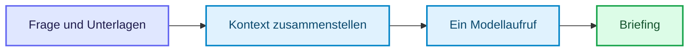
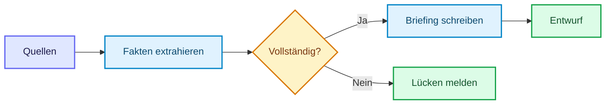
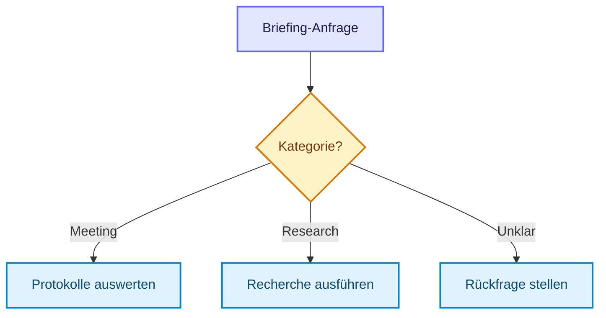
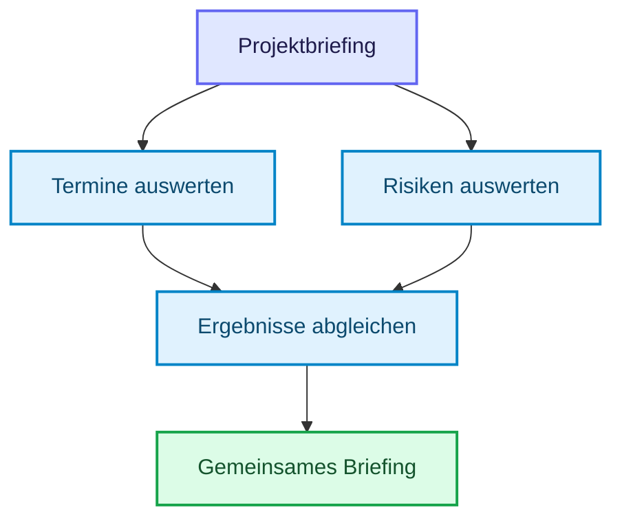
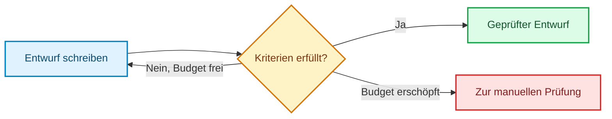
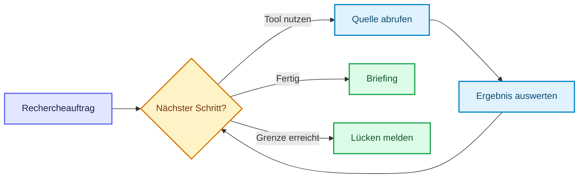
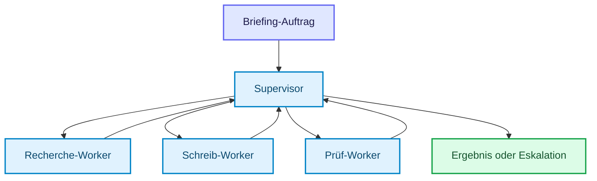
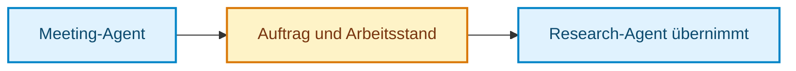

# Agenten-Architekturen
{: .no_toc }

> **Im Agent Lab ausprobieren:** [Agenten-Architekturen]({{ '/visualisierungen/agent_patterns_lab/#augmented' | relative_url }}){:target="_blank" rel="noopener"} (neuer Tab).

> **Wähle die einfachste Struktur, die deine Aufgabe zuverlässig löst.**

Dieses Kapitel ist die gemeinsame Übersicht über die wichtigsten Muster. Es hilft dir zu entscheiden, wer den Ablauf bestimmt, welche Rollen gebraucht werden und wo Ergebnisse geprüft werden. Die praktische Teamumsetzung folgt in [Multi-Agent-Systeme umsetzen]({{ '/02-architekturen/multi-agent-systeme.html' | relative_url }}).

**Einstieg:** Wähle mit der folgenden Tabelle eine passende Struktur und lies zunächst nur den zugehörigen Abschnitt. Erprobe dieses Muster anschließend im [Agent Lab]({{ '/visualisierungen/agent_patterns_lab/#augmented' | relative_url }}){:target="_blank" rel="noopener"}. Das Lab enthält 16 Architektur-Demos: 15 Muster und die sequenzielle PMO-Agenten-Pipeline als Kursbeispiel. Hinzu kommen zwei Harness-Kontrollen für menschliche Freigabe und deterministische Regeln. Die Architektur-Demos sind ein Nachschlageangebot, keine vollständig abzuarbeitende Übungsliste. Beginne im Mock-Modus; WebGPU ist optional.

---

# Inhaltsverzeichnis
{: .no_toc .text-delta }

1. TOC
{:toc}

---

## Welche Struktur braucht meine Aufgabe?

Ein Meeting- und Research-Briefing-Agent soll vor einem Projekttermin Quellen zusammenfassen, offene Fragen benennen und ein belegtes Briefing erstellen. Je nach Anforderung braucht er unterschiedliche Strukturen:

| Anforderung | Sinnvoller Einstieg |
|---|---|
| Relevante Unterlagen liegen bereits vor. | Augmented LLM: ein Modellaufruf mit bereitgestelltem Kontext |
| Quellen sammeln, Fakten extrahieren und schreiben sind feste Schritte. | Workflow mit Verkettung und Prüfungen |
| Die Anfrage bestimmt die benötigte Bearbeitung. | Workflow mit Routing |
| Unabhängige Teilfragen können gleichzeitig bearbeitet werden. | Parallele Teilaufgaben mit Zusammenführung |
| Erst gefundene Quellen zeigen, welche Recherche als Nächstes nötig ist. | Einzelner Agent mit ReAct-Schleife |
| Getrennte Fachkontexte, Tools oder Verantwortlichkeiten sind erforderlich. | Mehrere spezialisierte Agenten |

Diese Möglichkeiten sind **keine aufeinanderfolgenden Entwicklungsstufen**. Unterscheide drei Fragen:

- **Ablauf:** Gibt Code die Schritte vor oder entscheidet das Modell über die nächsten Aktionen?
- **Verantwortung:** Bearbeitet eine Rolle die Aufgabe oder werden Aufgaben an getrennte Rollen delegiert?
- **Kontrolle:** Welche Ergebnisse und Aktionen müssen Regeln, Prüfungen oder Menschen freigeben?

Ein Workflow kann mehrere Agenten enthalten. Ein einzelner Agent kann mehrere Tools nutzen. Menschliche Freigaben lassen sich in beide Formen einbauen.

**Begriffe:** Ein *Tool* ist eine aufrufbare Funktion. *State* bezeichnet den aktuellen Arbeitsstand. Ein *Workflow* legt mögliche Übergänge im Code fest. Bei einem *Agenten* bestimmt das Modell innerhalb dieser Grenzen selbst die nächsten Aktionen. Mehrere Modellaufrufe allein machen noch kein Agententeam.

## Grundbaustein: Augmented LLM

**Idee:** Ein Modell erhält zusätzlich zur Frage relevante Daten: Dokumentauszüge, zuvor abgerufene Tool-Ergebnisse oder passende gespeicherte Informationen. Ein Modellaufruf erzeugt daraus die Antwort.

**Beispiel:** Die Anwendung lädt das letzte Protokoll und den Projektstatus. Das Modell erstellt daraus das Terminbriefing mit Quellenangaben.

**Einsatzgrenze:** Fehlende oder falsche Daten werden durch den Modellaufruf nicht behoben. Soll das System selbst über weitere Rechercheschritte entscheiden, reicht diese feste Struktur nicht mehr aus. Ein Augmented LLM ist ein Baustein und noch kein autonom handelnder Agent.

### Tool-Calling ist eine Fähigkeit

Beim Tool-Calling schlägt das Modell eine Funktion und deren Argumente vor. Die Anwendung prüft den Aufruf, führt ihn aus und gibt das Ergebnis zurück. Das kann ein begrenzter Bestandteil eines Workflows oder eine wiederholte Aktion innerhalb eines Agenten sein.

Für das Briefing könnte ein Tool Projektunterlagen abrufen. Ob danach ein weiterer Aufruf erlaubt ist, entscheidet die umgebende Ablaufsteuerung. Tool-Calling steht deshalb nicht als eigene Architekturklasse neben Workflow oder Multi-Agent. Details erklärt [Tool Use & Function Calling]({{ '/03-entwicklung/prompts-werkzeuge/tool-use-function-calling.html' | relative_url }}).

## Vorgegebene Workflows

Bei einem Workflow stehen mögliche Schritte und Übergänge im Code. Einzelne Modellantworten können variieren; auch eine Klassifikation kann vom Modell stammen. Die Anwendung legt jedoch fest, welche Fortsetzung jeweils erlaubt ist.

### Verkettung: bekannte Schritte nacheinander ausführen

**Idee:** Prompt Chaining oder Pipeline zerlegt die Aufgabe in feste Schritte. Jedes Zwischenergebnis wird geprüft, bevor die nächste Stufe beginnt.

**Beispiel:** Protokolle einlesen, Beschlüsse und offene Aufgaben extrahieren, anschließend das Briefing formulieren.

**Einsatzgrenze:** Das Muster passt bei stabiler Reihenfolge. Übergib neben Zusammenfassungen auch Quellenverweise: Bei jeder Verdichtung können wichtige Details verloren gehen.

### Routing: die passende Bearbeitung auswählen

**Idee:** Eine Regel oder ein Modell klassifiziert die Anfrage. Code leitet sie an eine der vorgesehenen Bearbeitungen weiter.

**Beispiel:** Eine Terminvorbereitung nutzt interne Protokolle, eine Marktfrage startet eine Recherche.

**Einsatzgrenze:** Eine falsche Zuordnung führt zur falschen Bearbeitung. Validiere Kategorien und plane einen Fallback ein. Die Ziele können Funktionen, Modellaufrufe oder eigenständige Agenten sein; Routing setzt kein Agententeam voraus.

Interaktive Variante: [Modellstufen-Routing]({{ '/visualisierungen/agent_patterns_lab/#model_tiers' | relative_url }}){:target="_blank" rel="noopener"} vergleicht kleine, stärkere und regelbasiert gewählte Modellstufen an denselben PMO-Fällen. Ein Aufrufbudget begrenzt Fallbacks; fehlende Quellen führen zum Stopp. Ladezeiten werden getrennt ausgewiesen. Die vorgegebenen Mock-Unterschiede belegen keine reale Überlegenheit einer Strategie.

### Parallelisierung: unabhängige Teilaufgaben zusammenführen

**Idee:** Bei *Sectioning* bearbeiten mehrere Aufrufe unterschiedliche Teilfragen gleichzeitig. Ein Aggregator führt die Ergebnisse zusammen.

**Beispiel:** Terminlage und Projektrisiken werden unabhängig analysiert und danach auf Widersprüche geprüft.

**Einsatzgrenze:** Abhängige Schritte werden durch Parallelisierung nicht schneller. Die Zusammenführung braucht Regeln für Widersprüche, fehlende Ergebnisse und Quellen.

Eine Variante ist **Voting**: Mehrere Aufrufe beantworten dieselbe Frage; die Anwendung aggregiert ihre Antworten. Übereinstimmung ist kein Wahrheitsbeleg. Aufrufe desselben Modells können dieselben Fehler teilen. Für das Briefing ersetzt eine Mehrheit keine Prüfung an Originalquellen.

### Evaluator-Optimizer: Entwurf prüfen und überarbeiten

**Idee:** Ein Generator erstellt einen Entwurf. Regeln und gegebenenfalls ein bewertendes Modell prüfen ihn nach festgelegten Kriterien. Rückmeldungen gehen in eine begrenzte Überarbeitungsschleife ein.

**Beispiel:** Das Review prüft Beschlüsse, offene Fragen und nachvollziehbare Belege. Fehlende Belege führen zur Überarbeitung.

**Einsatzgrenze:** Ohne klare Kriterien produziert die Schleife bloß weitere Formulierungen. Begrenze die Durchläufe; eine Modellbewertung garantiert keine sachliche Richtigkeit. Getrennte Generator- und Reviewer-Rollen sind möglich, aber nicht zwingend eigenständige Agenten.

**Debate** ergänzt unabhängige Lösungsvorschläge und eine bewertende Instanz. Nutze diese Variante, wenn unterschiedliche Perspektiven den Mehraufwand rechtfertigen; eine Einigung ersetzt keine Evidenz.

## Ein Agent entscheidet den nächsten Schritt

### ReAct: beobachten, handeln und neu entscheiden

**Idee:** Ein Agent wählt anhand des bisherigen Ergebnisses die nächste Aktion. Bei ReAct wechseln sich Entscheidung, Tool-Aufruf und Beobachtung ab, bis das Ziel oder eine Grenze erreicht ist.

**Beispiel:** Eine Quelle nennt einen ungeklärten Termin. Der Agent sucht einen neueren Statusbericht und entscheidet danach, ob weitere Recherche nötig ist.

**Einsatzgrenze:** ReAct hilft bei offenen Lösungswegen. Es braucht begrenzte Tools, Kontext- und Aufrufbudgets sowie einen Abbruchpfad. Sichtbar gemacht werden Tool-Aufrufe, Ergebnisse und Prüfungen; eine interne Gedankenkette des Modells ist dafür nicht erforderlich.

### Explizite Planung als Ergänzung

Bei **Plan-and-Execute** wird zunächst ein prüfbarer Arbeitsplan erstellt und anschließend abgearbeitet. Neue Beobachtungen können Planänderungen auslösen. Im Briefing-Fall enthält der Plan Teilfragen, benötigte Quellen und Prüfkriterien.

Planung kann innerhalb eines Agenten oder zwischen Planner und mehreren Ausführenden stattfinden. Sie ist keine zusätzliche Architekturklasse. Für riskante Aufgaben lassen sich Recherche, Planung und Ausführung durch unterschiedliche Berechtigungen begrenzen. Ein Plan erteilt keine pauschale Freigabe für spätere Aktionen.

## Mehrere Agenten arbeiten zusammen

Mehrere Rollen helfen, wenn Fachkontexte, Werkzeuge oder Verantwortlichkeiten sinnvoll getrennt werden müssen. Für das Briefing könnte eine Recherche-Rolle Quellen erschließen, eine Schreib-Rolle den Entwurf erstellen und eine Prüf-Rolle Belege kontrollieren. Eine feste Abfolge solcher Rollen bleibt zugleich ein Workflow.

### Orchestrator-Workers: zentral delegieren

**Idee:** Ein Orchestrator oder Supervisor beauftragt spezialisierte Worker und führt Ergebnisse zusammen. Bei dynamischer Orchestrierung entscheidet das Modell erst während des Laufs, welche Teilaufgaben nötig sind.

**Beispiel:** Der Supervisor erkennt eine Quellenlücke und beauftragt eine weitere Recherche, bevor das Briefing geschrieben wird.

**Einsatzgrenze:** Delegation benötigt klare Aufträge, Ergebnisformate und Budgets. Der Supervisor kann zum Engpass werden. Ein einfacher Workflow genügt, wenn Reihenfolge und Aufgaben feststehen.

### Handoff: Verantwortung gezielt übergeben

**Idee:** Die bearbeitende Rolle erkennt einen Zuständigkeitswechsel und übergibt die weitere Bearbeitung an eine andere Rolle. Anders als beim Worker-Aufruf geht die Führung der Bearbeitung über.

**Beispiel:** Aus einer Protokollfrage entsteht ein Rechercheauftrag, den die Research-Rolle weiterführt.

**Einsatzgrenze:** Übergib Ziel, belegte Ergebnisse, Quellen, offene Fragen und verbleibendes Budget. Bloße Gesprächsweitergabe lässt Verantwortung und Bearbeitungsstand unklar.

Interaktive Demo: [Handoff im Agent Lab]({{ '/visualisierungen/agent_patterns_lab/#handoff' | relative_url }}){:target="_blank" rel="noopener"} – der Übergabe-Check prüft diese Pflichtfelder deterministisch; das kleine Modell reicht nur das Gespräch weiter und fällt durch.

### Fortgeschrittene Varianten und einfachere Alternativen

- **Hierarchie:** Leitrollen koordinieren Unterteams. Das lohnt sich erst bei getrennten Teilbereichen; jede zusätzliche Ebene erhöht den Abstimmungsaufwand.
- **Swarm / Peer-to-Peer:** Rollen koordinieren sich ohne festen Supervisor, etwa durch Handoffs. Handoff ist der Übergabemechanismus; Swarm beschreibt eine mögliche Teamorganisation. Globale Abschluss- und Kostenregeln bleiben erforderlich.
- **Skills statt weiterer Agenten:** Ein Agent lädt Fachwissen oder Werkzeuge nach. Prüfe diese Alternative, wenn nur der aktive Kontext zu groß wird. Siehe [Skills]({{ '/03-entwicklung/prompts-werkzeuge/skills.html' | relative_url }}) und [Capability-Loading im Lab]({{ '/visualisierungen/agent_patterns_lab/#skills' | relative_url }}){:target="_blank" rel="noopener"}. Dort lädt derselbe Agent aus einer festen Registry eine Fachanweisung und ein begrenztes Tool; die Anwendung prüft die Berechtigungen.

Rollen, Übergaben, gemeinsamer State und Fehlerbehandlung werden in [Multi-Agent-Systeme umsetzen]({{ '/02-architekturen/multi-agent-systeme.html' | relative_url }}) praktisch ausgearbeitet.

## Kontrolle für jedes Muster

Die Kontrollschicht um Modell und Tools heißt **Harness**. Sie setzt Berechtigungen durch, prüft Ergebnisse, begrenzt Schleifen und behandelt Fehler. Das gilt für einen Modellaufruf ebenso wie für ein Agententeam.

| Kontrollpunkt | Umsetzung beim Briefing-Agenten |
|---|---|
| Eingaben und Tool-Aufrufe validieren | Erlaubte Quellen und Argumente prüfen; Dokumentinhalte als Daten behandeln |
| Ergebnisse an Belegen prüfen | Quellen-IDs technisch validieren und Aussagen mit Originalstellen abgleichen |
| Geschäftsregeln in Code durchsetzen | Vertrauliche Unterlagen unabhängig von der Modellmeinung vom Versand ausschließen |
| Kontext und Arbeit begrenzen | Quellen gezielt auswählen, Aufrufe und Überarbeitungen begrenzen |
| Fehler sichtbar beenden | Unvollständiges Briefing mit offenen Punkten kennzeichnen |
| Menschliche Freigabe einbauen | Externen Versand erst nach ausdrücklicher Freigabe ausführen |

Eine Freigabe muss das konkrete Artefakt und die konkrete Aktion betreffen. Auch Menschen können Fehler übersehen. Weder Human-in-the-Loop noch eine weitere Modellprüfung ersetzen technische Berechtigungen und nachvollziehbare Belege.

Details stehen in [Agent Harness]({{ '/05-qualitaet-sicherheit/agent-harness.html' | relative_url }}), [Loop Engineering]({{ '/03-entwicklung/loop-engineering.html' | relative_url }}) und [Human-in-the-Loop]({{ '/03-entwicklung/state-checkpoints/human-in-the-loop.html' | relative_url }}).

## Muster vergleichen und auswählen

| Muster | Wer steuert den Ablauf? | Geeignet für | Typische Grenze |
|---|---|---|---|
| Augmented LLM | Code stellt Kontext bereit | Antworten aus vorliegenden Unterlagen | Qualität hängt vom Kontext ab |
| Verkettung | Code bestimmt Reihenfolge | Bekannte Verarbeitungsschritte | Informationsverlust an Übergängen |
| Routing | Code erlaubt Pfade; Regel oder Modell wählt | Unterschiedliche Anfragearten | Falsche Zuordnung; Fallback erforderlich |
| Parallelisierung | Code verteilt und sammelt | Unabhängige Teilfragen | Zusammenführung und Widersprüche |
| Evaluator-Optimizer | Code begrenzt Prüfschleife | Entwürfe mit prüfbaren Kriterien | Reviewer kann irren |
| ReAct | Modell wählt nächste Aktion | Explorative Recherche und Tool-Nutzung | Abbruchgrenzen nötig |
| Supervisor / Orchestrator-Workers | Zentrale Rolle delegiert | Unterschiedliche, teils erst entstehende Aufgaben | Koordination und Kontextübergaben |
| Handoff | Bearbeitende Rolle übergibt | Wechselnde Zuständigkeit | Abschlussverantwortung und Kontexttransfer |

Die Tabelle ist eine Auswahlhilfe, keine Rangfolge. Prüfe zuerst den Bedarf an freien Entscheidungen und getrennten Rollen. Ergänze anschließend die notwendigen Kontrollen.

### Kosten und Latenz abschätzen

| Muster | Zusätzliche Modellaufrufe / Kosten | Typischer Einfluss auf die Latenz |
|---|---|---|
| Augmented LLM | Ein Generierungsaufruf; Retrieval kann weitere Kosten verursachen | Keine Generierungsschleife; Abrufzeit kommt hinzu |
| Verkettung | Ein oder mehrere Aufrufe pro Stufe | Sequenzielle Stufen addieren ihre Laufzeit |
| Routing | Bei Modellklassifikation zusätzlicher Router-Aufruf | Klassifikation liegt vor der gewählten Bearbeitung |
| Parallelisierung / Voting | Aufrufe je Teilaufgabe oder Stichprobe, gegebenenfalls Aggregator | Parallelität kann Wartezeit senken; Zusammenführung bleibt |
| Evaluator-Optimizer | Generierung und Prüfung je Runde | Jede Überarbeitung verlängert den Lauf |
| ReAct | Variable Anzahl von Modell- und Tool-Aufrufen | Abhängig von Beobachtungen und Schleifen |
| Supervisor / Orchestrator-Workers | Delegation, Worker und Zusammenführung | Abhängig von paralleler oder sequenzieller Bearbeitung |
| Handoff | Weitere Aufrufe je Übergabe und Bearbeitung | Übergaben verlängern den Bearbeitungspfad |

Das sind qualitative Erwartungen bei vergleichbarer Aufgabe und Modellwahl. Tokenmenge, Kontextlänge, Tool-Laufzeiten und Wiederholungen bestimmen die tatsächlichen Kosten. Weniger Wartezeit bedeutet bei parallelen Aufrufen nicht automatisch geringere Kosten.

**Für den ersten Kursagenten:** Beginne mit einem Briefing aus bereitgestellten Quellen. Ergänze feste Extraktions- und Prüfschritte. Öffne die Recherche für freie Tool-Entscheidungen, wenn diese nötig sind. Teile die Verantwortung erst auf, wenn getrennte Rollen einen messbaren Nutzen bringen.

Vergleiche Varianten mit denselben Aufgaben, Quellen und Qualitätskriterien. Erfasse Modell- und Tool-Aufrufe, Token-Verbrauch, Laufzeit und akzeptierte Ergebnisse. Einzelne Demo-Läufe mit unterschiedlichen Aufgaben belegen keine allgemeine Überlegenheit eines Musters.

Interaktive Übung: [Evaluation im Agent Lab]({{ '/visualisierungen/agent_patterns_lab/#evaluation' | relative_url }}){:target="_blank" rel="noopener"} – Verkettung, ReAct und die sequenzielle Agenten-Pipeline mit denselben Fällen und festen Regelchecks vergleichen. Mock-Ergebnisse sind vorgegeben; die automatischen Checks ersetzen keine fachliche Bewertung des freien Antworttexts.

## Quellen und nächste Schritte

- [Anthropic: Building effective agents](https://www.anthropic.com/research/building-effective-agents) – Grundbausteine, Workflows und modellgesteuerte Agenten.
- [LangChain: Multi-agent](https://docs.langchain.com/oss/python/langchain/multi-agent) – Rollenaufteilung, Kontext und kombinierbare Muster.
- [LangGraph: Workflows and agents](https://docs.langchain.com/oss/python/langgraph/workflows-agents) – Verkettung, Routing, Parallelisierung und Orchestrator-Workers mit Codebeispielen.
- [Vishal Mysore: 12 AI Agent Design Patterns Explained](https://medium.com/@visrow/12-ai-agent-design-patterns-explained-react-multi-agent-human-in-the-loop-live-browser-demo-7905f7889712) und [englische Original-Demo von Vishal Mysore](https://vishalmysore.github.io/harnessEngineeringDemo/patterns.html#augmented) – ergänzende Beispiele und Demonstration; Messwerte gelten für die jeweiligen Versuchsläufe. Das deutschsprachige Kurs-Lab ist oben separat verlinkt.
- [Interaktive Architektur-Demo]({{ '/visualisierungen/ki_agent_architektur/' | relative_url }}) – ergänzende Darstellung; für die Einordnung der Muster gilt dieses Kapitel.

**Weiter im Kurs:** [Aufgaben & Lösungswege]({{ '/02-architekturen/aufgabenklassen-und-loesungswege.html' | relative_url }}) begründet den Agentenbedarf. [Multi-Agent-Systeme umsetzen]({{ '/02-architekturen/multi-agent-systeme.html' | relative_url }}) zeigt die Teamumsetzung. [State Management]({{ '/03-entwicklung/state-checkpoints/state-management.html' | relative_url }}) erklärt den Arbeitsstand zwischen Schritten.

---

**Version:** 2.0 
**Stand:** November 2026 
**Kurs:** KI-Agenten. Planen. Handeln. Prüfen.
