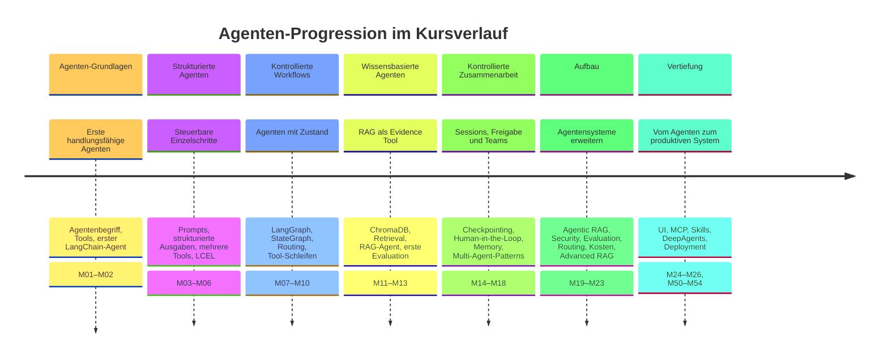

# Kursüberblick
{: .no_toc }

> **KI-Agenten. Planen. Handeln. Prüfen.**

---

## Inhaltsverzeichnis
{: .no_toc .text-delta }

1. TOC
{:toc}

---

## Worum es in diesem Kurs geht

Der Kurs zeigt, wie aus einzelnen KI-Funktionen kontrollierte Agentensysteme werden: Anwendungen, die planen, Werkzeuge nutzen, Zwischenergebnisse prüfen und bei Bedarf Menschen einbeziehen.

Der rote Faden ist ein **PMO-Assistent**. Er unterstützt die Meeting-Vorbereitung, die Aufbereitung von Besprechungs- und Projektdokumenten, die Aufgabenverfolgung sowie die Erstellung quellengebundener Briefings und Statusübersichten. Dazu arbeitet er mit einem kuratierten Projektkorpus, sucht relevante Passagen, erstellt belegbare Antworten, erkennt Grenzen des Wissens und macht kritische Ausgaben prüfbar. Er ersetzt kein vollständiges PMO-System und trifft keine verbindlichen Projektentscheidungen.

Der Fokus liegt auf praktischer Umsetzung mit Python, LangChain, LangGraph, LangSmith und ChromaDB. Theorie wird so weit erklärt, wie sie für Entwurf, Implementierung und Bewertung nötig ist.

## Zielgruppe

Der Kurs passt besonders für:

- Entwicklerinnen und Entwickler mit Python-Grundlagen,
- IT-Fachkräfte, die KI-Agenten in Arbeitsprozesse einordnen möchten,
- fortgeschrittene GenAI-Anwenderinnen und -Anwender, die von Prompts und Chains zu kontrollierten Workflows wechseln wollen.

Hilfreich sind sichere Grundlagen in Python, Jupyter/Colab und API-Nutzung.

Der Kurs baut auf dem GenAI-Kurs auf. Wer Prompting, Modellaufrufe, Chains, RAG und strukturierte Ausgaben kennt, kann sich hier auf kontrollierte Handlung, Zustand, Tool-Auswahl, Freigabe und Evaluation konzentrieren.

## Was der Kurs vermittelt

Nach dem Kurs ist es möglich:

- Agenten von Chatbots, Chains und klassischen Workflows abzugrenzen,
- Tools, Prompts, State und Routing gezielt zu kombinieren,
- sichtbare Planungs-, Tool- und Prüf-Artefakte statt versteckter Gedankengänge zu nutzen,
- RAG als Evidence Tool in Agenten einzubinden,
- LangGraph für kontrollierte mehrstufige Abläufe zu nutzen,
- Human-in-the-Loop im Grundlagenpfad umzusetzen und Evaluation, Security und Budgetkontrolle über die Aufbaumodule einzuplanen,
- einen PMO-Assistenten für Meeting-Vorbereitung, Dokumentenaufbereitung, Aufgabenverfolgung sowie quellengebundene Briefings und Statusübersichten weiterzuentwickeln.

Das praktische Ergebnis ist kein loses Beispielset, sondern ein wachsendes Zielsystem: ein Agent, der Projektmaterial durchsucht, Meeting-Briefings und Statusübersichten erstellt, offene Aufgaben strukturiert erfasst, relevante Evidenz sammelt, menschliche Freigaben einbezieht und am Ende als überprüfbarer Prototyp weitergeführt werden kann.

## Kursstruktur

Der Kurs umfasst 31 reguläre Kursmodule: M01–M26 und die optionale Vertiefungsreihe M50–M54. Der gemeinsame Kernpfad umfasst M01–M18. In diesen Kern-Notebooks sind die Grundlagenaufgaben das gemeinsame Mindestziel; Aufbau- und Vertiefungsaufgaben sind Wahlangebote. Ab Tag 3 wird nach Checkpoints differenziert.

| Kurstag   | Schwerpunkt                                                    | Grundlagen / Kern | Aufbau im Kurs (optional)                               | Vertiefung an Tag 5 (optional)                                                             |
| --------- | -------------------------------------------------------------- | ----------------- | ------------------------------------------------------- | ------------------------------------------------------------------------------------------ |
| **Tag 1** | Agentenbegriff, erste Tools und erster Agent                   | M01–M02           | —                                                       | —                                                                                          |
| **Tag 2** | Prompts, strukturierte Ausgaben, mehrere Tools und LCEL        | M03–M06           | —                                                       | —                                                                                          |
| **Tag 3** | LangGraph, State, Routing und Tool-Schleifen                   | M07–M10           | M20 Agent Security Best Practices                       | —                                                                                          |
| **Tag 4** | RAG, Retrieval als Tool und erste Evaluation                   | M11–M13           | M19 Agentic RAG, M21 Agent Evaluation, M23 Advanced RAG | —                                                                                          |
| **Tag 5** | Sessions, Freigaben, Delegation und Multi-Agent-Zusammenarbeit | M14–M18           | —                                                       | M24 Gradio UI, M26 Agent Skill Compliance, M52 DeepAgents Skill, M54 Production Deployment |

Die optionalen Module sind keine Voraussetzung für die gemeinsamen Kursziele. M22 wird nach Zeit und Kursziel als Aufbau ausgewählt; M25 sowie M50, M51 und M53 sind weiterführendes Material. M50 ist der Einstieg in das Vertiefungsthema DeepAgents, nicht Teil des gemeinsamen Grundlagenkerns.

### Kursprogression auf einen Blick

Die Timeline zeigt den Grundlagenpfad nach Themenblöcken. Anschließend folgen die optionalen Module für Aufbau und Vertiefung; die Modul-IDs entsprechen der Kurstabelle und der Zusatzübersicht.

Im Tag-5-Block spielen die Teilnehmenden nach Human-in-the-Loop eine 15- bis 20-minütige KI-Delegation-Poker-Runde. Am PMO-Assistenten entscheiden sie, welche Schritte autonom laufen dürfen und wo eine menschliche Freigabe nötig ist.

### Weitere Zusatznotebooks außerhalb der Tagesübersicht

Diese optionalen Materialien sind nicht fest in die fünf Kurstage eingeplant.

| Stufe | Notebook | Einsatz |
|---|---|---|
| Aufbau | `M22_Model_Routing_Cost_Control.ipynb` | Routing, Fallbacks und Kostenkontrolle ergänzen. |
| Vertiefung | `M25_MCP_Local.ipynb` | Lokale MCP-Server als weiterführende Tool-Integration nutzen. |
| Vertiefung | `M50_DeepAgents_Harness.ipynb`, `M51_DeepAgents_Vertiefung.ipynb`, `M53_DeepAgent_Multi_Skill.ipynb` | DeepAgents kennenlernen und nach Interesse ausbauen. M50 ist der Einstieg in dieses Vertiefungsthema. |
| Referenz | `M40_PMO_Assistent_Referenzimplementierung.ipynb` | Eine ergänzende Lösung zum Nachschlagen und Vergleichen. |

## Kursblöcke am PMO-Assistenten

Jeder Block ergänzt dasselbe Zielsystem: Tools und Prompts schaffen Handlungsmöglichkeiten, LangGraph macht Abläufe steuerbar, RAG liefert Quellen und HITL sowie Evaluation machen Ergebnisse prüfbar. Aufbau- und Vertiefungsnotebooks erweitern diese Fähigkeiten gezielt.

Einige Begriffe sind bewusst knapp gehalten. **Evidence Tool** meint ein Retrieval-Werkzeug, das Antworten mit Quellenmaterial verbindet. **Out-of-Context-Stopp** bedeutet, dass der Agent anhält, wenn die vorhandenen Quellen keine belastbare Antwort tragen. **Circuit Breaker** bezeichnet eine Schutzschaltung, die Abläufe bei Fehlern, Kosten- oder Qualitätsgrenzen stoppt.

## Vorbereitung

Für die praktischen Übungen werden typischerweise benötigt:

- ein Google-Account für Google Colab und Google Drive,
- ein OpenAI-Account mit API-Key und kleinem API-Guthaben,
- ein LangSmith-Account für Tracing, Debugging und Evaluation,
- ein Gerät, auf dem Browser, Notebook-Umgebung und Kursmaterial zuverlässig funktionieren,
- Grundverständnis von Python-Funktionen, Decorators, Type Hints, Dictionaries und Fehlerbehandlung.

Google Colab und Google Drive sind vor allem für den gemeinsamen Kursbetrieb praktisch. Wer lokal arbeitet, braucht stattdessen eine funktionierende Python-Umgebung mit Zugriff auf die Kursnotebooks. LangSmith wird für Beobachtung und Evaluation empfohlen; einzelne Grundlagen lassen sich auch ohne LangSmith nachvollziehen, verlieren dann aber den Trace- und Bewertungsblick.

Bei Business-Laptops sollte vorab geprüft werden, ob Cloud-Dienste, API-Zugriffe, GitHub, Google Colab und LangSmith durch die IT-Richtlinien erlaubt sind.

Nützliche Einstiege:

- [OpenAI Platform](https://platform.openai.com/)
- [LangSmith](https://smith.langchain.com/)
- [Google Colab](https://colab.research.google.com/)

## Arbeitsweise

Der Kurs ist als Werkstatt aufgebaut. Die Notebooks sind nicht nur Lesematerial, sondern sollen ausgeführt, verändert und kritisch geprüft werden. Jede größere Technik wird am PMO-Assistenten eingeordnet: Was plant der Agent, welche Handlung führt er aus, und wie wird das Ergebnis geprüft?

Sinnvoll ist es, eigene Fragen oder kleine Prozessideen mitzubringen. Dadurch wird schneller sichtbar, wann ein Agent wirklich hilft und wann ein klassischer Workflow, eine einfache Chain oder ein RAG-System ohne Agent ausreicht.

## Lernen mit KI

Generative KI darf im Kurs als Lern- und Entwicklungshilfe genutzt werden. Bei Fehlermeldungen, Verständnisfragen oder Varianten kann ein Modell Teilschritte erklären oder alternative Implementierungen vorschlagen.

Die Grenze bleibt wichtig: KI ersetzt nicht das eigene Verständnis. Der Schwerpunkt liegt darauf, Agentensysteme selbst zu entwerfen, auszuführen, zu beobachten und zu bewerten.

## Kompetenzillusion vermeiden

Agenten-Demos können überzeugend wirken, obwohl wichtige Kontrollpunkte fehlen. Gerade bei mehrstufigen Systemen entsteht leicht der Eindruck, der Agent habe verstanden, geplant und geprüft, obwohl er nur plausibel formuliert.

<small>KI-generiertes Bild</small>

Deshalb gehören im Kurs immer drei Prüfbewegungen dazu:

- Tool-Aufrufe und Zwischenschritte sichtbar machen,
- Quellen, State und Entscheidungen nachvollziehen,
- Ergebnisse mit Tests, Human-in-the-Loop oder Evaluation prüfen.

## Aufgaben nach Vorkenntnissen und Lerntempo bearbeiten

Die Aufgaben je Modul sind in **Grundlagen**, **Aufbau** und **Vertiefung** unterteilt. Die Auswahl richtet sich nach **Vorkenntnissen** und **Lerntempo**: Grundlagen sichern das zentrale Verständnis, Aufbau-Aufgaben vertiefen die Anwendung, und Vertiefungsaufgaben bieten zusätzliche Übung, Varianten oder Transferfragen.

Einige Module enthalten außerdem den Unterabschnitt **Praxis-Transfer: PMO-Assistent**. Diesen Abschnitt sollten sich möglichst alle ansehen, weil er die jeweilige Technik mit dem durchgehenden Kursprojekt verbindet.

## Zeitfenster für Aufgaben

Für Übungsaufgaben hat sich ein kurzer Arbeitsrhythmus bewährt: etwa **10 Minuten Bearbeitungszeit**, ein kurzer **Zwischenstopp** und anschließend weitere **10 Minuten oder mehr**. Die erste Phase ist lang genug für den Einstieg und kurz genug, damit Blockaden früh sichtbar werden.

Der Zwischenstopp sollte niedrigschwellig sein. Statt nur zu fragen „Gibt es Fragen?“, hilft ein aktiver Check: zum Beispiel Daumen hoch/seitlich/runter oder eine kurze Zahl im Chat für den eigenen Fortschritt.

Der Check ist keine harte Pflicht-Unterbrechung für alle. Wer gut im Flow ist, kann weiterarbeiten; wer festhängt, bekommt früh Gelegenheit zur Klärung. Bei unterschiedlichem Tempo bleibt der Takt flexibel: Schnellere bearbeiten Aufbau- oder Vertiefungsaufgaben, langsamere sichern zunächst die Grundlagen.

Auch während der Übungszeit stehen Fragen jederzeit offen. Wer lieber ungestört im eigenen Flow bleiben möchte, schaltet dafür einfach den eigenen Lautsprecher **stumm**.

Statt der gestellten Aufgaben lässt sich bei Bedarf auch eine **eigene** Problemstellung bearbeiten. Unterstützung dafür gibt es, soweit es der Rahmen zulässt.

Fehler gehören zum Lernprozess dazu und sind kein Rückschlag: Eine Fehlermeldung zeigt oft genauer, wie ein System tatsächlich funktioniert, als ein Durchlauf ohne Probleme, und trägt damit direkt zum Lernerfolg bei.

## Nächste Schritte

| Dokument | Frage |
|---|---|
| [Lohnt es sich?](./lohnt-es-sich.html) | Ist ein Agent für diese Aufgabe überhaupt sinnvoll? |
| [Aufgabenklassen & Lösungswege](./aufgabenklassen-und-loesungswege.html) | Welche Lösungsklasse passt zur Aufgabe? |
| [PMO-Assistent](./pmo-assistent.html) | Welches Kursprojekt verbindet die Module? |
| [Lernpfad](../lernpfad.html) | Welche Dokumente passen zu meinem Lernziel? |

---

**Version:** 1.3 
**Stand:** Oktober 2026 
**Fachstand:** Oktober 2026; Versionsnummern sind dokumentbezogen. 
**Kurs:** KI-Agenten. Planen. Handeln. Prüfen.
