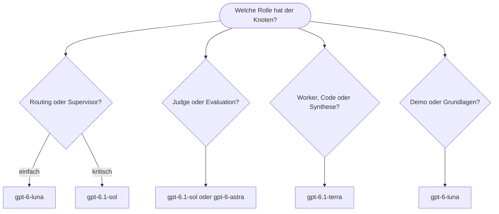
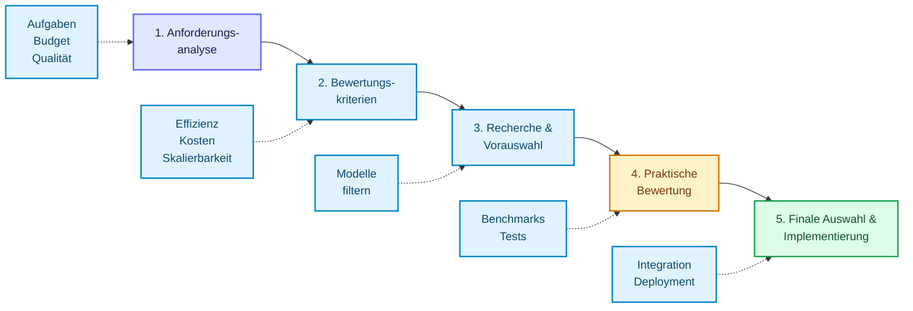

# Modellauswahl
{: .no_toc }

> [!NOTE] Kernfrage<br>
> Welches Modell passt zur Aufgabe, zum Risiko, zum Budget und zur Latenzanforderung?

---

# Inhaltsverzeichnis
{: .no_toc .text-delta }

1. TOC
{:toc}

---

## Modellrollen
Modellauswahl ist keine Rangliste. Ein Modell ist passend, wenn Qualität, Latenz, Kosten, Kontextfenster, Tool-Unterstützung und Modalität zur Aufgabe passen. Deshalb wird nicht überall ein einzelnes Modell fest eingetragen, sondern eine Rolle verwendet: Baseline, Router, Worker, Planner, Judge, Coding, Frontier oder Embedding.

Diese Rollen stehen in `genai_lib.model_config.py`. Die Datei ist die technische Referenz. Wer ein Notebook liest, soll nicht zuerst konkrete Produktnamen interpretieren müssen, sondern erkennen, welche Aufgabe ein Modell im Agentensystem übernimmt.

Typischer Fehler: Das stärkste verfügbare Modell wird als Standard gewählt. Für viele Agentenschritte sind Kosten, Latenz, Tool-Zuverlässigkeit oder strukturierte Ausgabe wichtiger als maximale Benchmark-Leistung.

| Rolle                        | Konstante                                 | Modell                                | Einsatz                                               |
| ---------------------------- | ----------------------------------------- | ------------------------------------- | ----------------------------------------------------- |
| Baseline / Demo              | `BASELINE`                                | `openai:gpt-6-luna`                   | einfache Beispiele, erste Läufe, Kostenkontrolle      |
| Router / leichter Reasoner   | `ROUTER`                                  | `openai:gpt-6-luna`                   | klare Auswahlentscheidungen mit wenigen Wegen         |
| Worker / Synthese            | `WORKER`                                  | `openai:gpt-6.1-terra`                | RAG-Synthese, strukturierte Ausgaben, Standard-Worker |
| Coding-Worker                | `CODING`                                  | `openai:gpt-6.1-terra`                | begrenzte Codegenerierung, Refactoring, technische Agenten |
| Judge / starker Reasoner     | `JUDGE`                                   | `openai:gpt-6.1-sol`                  | Bewertung, Evaluation, Supervisor, Compliance         |
| Planner                      | `PLANNER`                                 | `openai:gpt-6.1-sol`                  | Aufgabenzerlegung, Schrittplanung, Agentic RAG        |
| Hochwertiger Worker          | `WORKER_PREMIUM`                          | `openai:gpt-6.1-sol`                  | komplexe Synthese, finale Reports                     |
| Frontier / maximale Qualität | `FRONTIER`                                | `openai:gpt-6-astra`                  | schwierigste Coding-, Judge- und Agenten-Aufgaben     |
| Bildgenerierung              | `IMAGE_GENERATION`                        | `gpt-image-2`                         | Bildgenerierung über die OpenAI Images API            |
| Audio-Transkription          | `TRANSCRIPTION`                           | `gpt-transcribe`                      | Datei-Audiotranskription                              |
| Audio-Transkription (Legacy) | `TRANSCRIPTION_SEGMENTS`                  | `whisper-1`                           | Segment-Zeitstempel; Migration bis 26.02.2027 nötig  |
| Embeddings                   | `EMBEDDINGS`                              | `text-embedding-3-small`              | Retrieval, Chunk-Suche, Vektorindizes                 |

GPT-6-Modelle mit Tool-Aufrufen werden mit `langchain-openai` ab Version 1.7.2 über die Responses API geroutet. Bei einer eigenen `ChatOpenAI`-Konfiguration kann `use_responses_api=True` explizit gesetzt werden. `whisper-1` wird am 26. Februar 2027 abgeschaltet; die Segment-Zeitstempel benötigen eine gesonderte Migration.

Diese Rollen machen die Modellwahl überprüfbar. Entwickler vergleichen nicht beliebige Modellnamen, sondern entscheiden, ob ein Schritt Baseline, Router, Worker, Planner oder Judge ist. Die konkreten Modell-IDs sind Projektkonfiguration, nicht allgemeine Marktberatung. Vor produktiven Projekten muss die aktuelle Provider-Dokumentation geprüft werden, weil Modellverfügbarkeit, Preise und API-Parameter regelmäßig wechseln.

> [!IMPORTANT] Standard vor Produktname<br>
> In Notebooks werden nach Möglichkeit Rollen aus `model_config.py` verwendet. Harte Modellnamen stehen nur dort direkt im Notebook, wo ein bestimmter Endpunkt oder ein bewusstes Vergleichsexperiment gezeigt wird.


## Historischer Modellsteckbrief - Beispiel

<br>


<p><font color='black' size="2">
Historisches, KI-generiertes Beispiel für einen Modellsteckbrief (GPT-5.4 mini); es ist kein aktueller Kurs-Default.
</font></p>

**Modellübersichten:**      
+ [Models.dev — Open-Source-Datenbank für AI-Modelle](https://models.dev/)
+ [LiteLLM-Anbieter & Modelle](https://models.litellm.ai/)


## OpenAI-Default und Designregeln

Der Kurs nutzt die in **Modellrollen** aufgeführten OpenAI-Modelle als Defaults. Diese Tabelle ist die maßgebliche Zuordnung; die folgenden Regeln erklären, wie sie auf konkrete Aufgaben angewendet wird.

### Entscheidungsregeln

1. **Baseline zuerst:** Mit einem günstigen Standardmodell starten und erst bei messbarem Bedarf upgraden.
2. **Rolle vor Modell:** Erst klären, ob ein Knoten Router, Worker, Judge oder Planner ist.
3. **Fehlerkosten beachten:** Je teurer eine Fehlentscheidung wird, desto eher lohnt sich ein stärkeres Modell.
4. **Tool- und JSON-Verhalten prüfen:** Für Agenten zählt nicht nur Textqualität, sondern auch stabiler Tool Use und strukturierte Ausgabe.
5. **Kosten und Latenz sichtbar machen:** Modellwahl ist Teil der Architektur, nicht nur Qualitätsoptimierung.

## Entscheidungsbaum



## Provider-Mapping

Für providerneutrale Architekturentscheidungen bleibt die Rollenlogik erhalten: **Erst die Rolle definieren, dann den Provider und erst zuletzt den konkreten Modellnamen wählen.** Der Providerwechsel ist eine Zuordnung von Rollen auf passende Modellfamilien. Weiterhin gilt der OpenAI-Default aus der Tabelle oben; die Zuordnung dient der Einordnung und Architekturplanung und ändert nicht automatisch die in den Modulen verwendeten Modelle.

| Rolle                              | [OpenAI](https://platform.openai.com/docs/models) | [Mistral](https://docs.mistral.ai/models/) | [Gemini](https://ai.google.dev/gemini-api/docs/models) | [Anthropic](https://docs.anthropic.com/en/docs/about-claude/models-overview) | Kommentar                                                           |
| ---------------------------------- | ------------------------ | ---------------------------------------------------- | ----------------------------- | ------------------------------- | ------------------------------------------------------------------- |
| **Baseline / Demo**                | `gpt-6-luna`             | `mistral-small-2603`                                 | `gemini-3.5-flash-lite`       | `claude-haiku-4-5`              | schnell, günstig, gut für Grundlagen                                |
| **Router / leichter Reasoner**     | `gpt-6-luna`             | `mistral-small-2603`                                 | `gemini-3.5-flash-lite`       | `claude-haiku-4-5`              | für Routing und einfache Auswahlentscheidungen                      |
| **Judge / starker Reasoner**       | `gpt-6.1-sol`            | `mistral-medium-3-5` (hohes `reasoning_effort`)      | `gemini-4-argon`              | `claude-opus-5`                 | für Supervisor, Security, Bewertung                                 |
| **Worker / Synthese**              | `gpt-6.1-terra`          | `mistral-medium-3-5`                                 | `gemini-3.8-flash`            | `claude-sonnet-5`               | Standard-Worker: starke Ausgabe, kostensensitiv                     |
| **Worker / Synthese (hochwertig)** | `gpt-6.1-sol`            | `mistral-large-4` (Preview)                          | `gemini-4-argon`              | `claude-opus-5`                 | hohe Qualität: komplexe RAG, finale Reports                         |
| **Frontier / maximale Qualität**   | `gpt-6-astra`            | `mistral-large-4` (Preview)                          | `gemini-4-argon`              | `claude-fable-5`                | maximale Qualität für schwierige Coding-, Judge- und Agenten-Aufgaben |
| **Coding-Worker**                  | `gpt-6.1-terra`          | `mistral-medium-3-5` oder `codestral-2508`           | `gemini-3.8-flash`            | `claude-sonnet-5`               | Codestral für Code-Vervollständigung, Medium 3.5 für Coding-Agenten |
| **Embeddings**                     | `text-embedding-3-small` | `mistral-embed`                                      | `gemini-embedding-2`          | externer Provider nötig         | Anthropic bietet hier keinen direkten Standardersatz |

> [!NOTE] Provider-Mapping ist Planung, keine automatische Migration<br>
> Das Mapping ist funktionsorientiert, nicht benchmark-orientiert. Ein anderes Chat-Modell ersetzt nicht automatisch Embeddings, Logging, Kostenmodell oder API-spezifische Parameter. Chat-Modell und Embedding-Modell sind **zwei getrennte Entscheidungen** — ein Wechsel des einen zieht den anderen nicht nach sich.

Die Modell-IDs und Lifecycle-Angaben sind Momentaufnahmen, geprüft am 27. Oktober 2026. Anthropic führt `claude-haiku-4-5`, `claude-sonnet-5`, `claude-opus-5` und `claude-fable-5` als aktive Modelle. Google hat `gemini-embedding-2-preview` am 10. August 2026 abgeschaltet; verwende das stabile `gemini-embedding-2`. Prüfe vor einer Integration die verlinkten offiziellen Modellübersichten und Deprecation-Seiten erneut.

### Wie die Provider zu lesen sind

#### OpenAI

OpenAI ist im Projekt derzeit der **Kurs-Default**:

- starkes Rollenmodell im bestehenden Kurs
- konkrete Zuordnung in den Notebooks bereits umgesetzt
- Agent Builder als OpenAI-spezifisches Zusatzmodul
- Embeddings direkt im bestehenden RAG-Pfad verankert

**Geeignet, wenn**
- bestehende Kurslogik unverändert bleiben soll
- Notebooks 1:1 weiterlaufen sollen
- die Modellunterscheidung im Unterricht explizit gezeigt wird

#### Mistral

Mistral ist besonders interessant, wenn ein **breiter Single-Provider-Pfad** angestrebt wird:

- Generalmodelle (`mistral-small-2603`, `mistral-medium-3-5`, `mistral-large-4`)
- einstellbares Reasoning über `reasoning_effort` bei `mistral-medium-3-5`; `mistral-small-2603` vereint Instruct, Reasoning und Coding; die früheren `magistral-*`-Modelle sind abgekündigt
- Coding-Modelle (`codestral-2508` für Code-Vervollständigung), `devstral-2512` ist abgekündigt und wird durch Medium 3.5 ersetzt
- Audio-Modelle
- Embeddings (`mistral-embed`)

**Geeignet, wenn**
- ein stärker providerneutraler oder europäischer Stack gewünscht ist
- Audio, Coding und Embeddings möglichst in einer Produktwelt liegen sollen
- man OpenAI nicht als alleinigen Standard setzen möchte

**Einschränkung**
- `mistral-large-4` ist aktuell Public Preview; Lifecycle-Angaben stehen in der [Mistral Model Lifecycle Policy](https://docs.mistral.ai/inference/model-lifecycle)
- `-latest`-Aliase können auf wechselnde Versionen zeigen; für stabile Läufe die konkrete Versions-ID wie `mistral-medium-3-5` verwenden

#### Gemini

Google Gemini eignet sich gut für **multimodale und skalierbare Workloads**:

- Flaggschiff für komplexe Reasoning- und Agenten-Aufgaben (`gemini-4-argon`)
- Flash-Modelle für günstige, schnelle Läufe (`gemini-3.8-flash`, `gemini-3.5-flash-lite`)
- Eigene Embedding-Modelle (`gemini-embedding-2`)
- Langer Kontext (1 Mio. Tokens bei `gemini-4-argon`) für Dokument-Handoffs
- Eingabe von Text, Bild, Video, Audio und PDF

**Geeignet, wenn**
- multimodale Inhalte (Bild, Video, Audio) im Agenten-System verarbeitet werden
- ein langer Kontextpfad für große Dokumente benötigt wird
- Google Cloud / Vertex AI als Deployment-Plattform geplant ist

**Einschränkung**
- kein spezialisiertes Coding-Modell (Mistral `codestral-2508` hat hier einen Vorteil)
- Preview-Modelle können sich ändern; `gemini-embedding-2` ist die stabile Version. Die [Gemini Deprecations-Seite](https://ai.google.dev/gemini-api/docs/deprecations) führt Abschaltungen und Ersatzmodelle auf.
- ältere Modelle wie `gemini-3-pro-preview` und `gemini-2.0-flash` sind bereits abgeschaltet

#### Anthropic

Anthropic passt oft sehr gut auf die **Rollenlogik** des Kurses:

- Haiku als schnelle Baseline (`claude-haiku-4-5`)
- Sonnet als starker Standard-Worker (`claude-sonnet-5`)
- Opus als Judge / Supervisor / hochwertiger Worker (`claude-opus-5`)
- Fable als Frontier-Modell für anspruchsvolles Reasoning (`claude-fable-5`)

Anthropic veröffentlicht Status und Retirement-Termine auf der [Model Deprecations-Seite](https://docs.anthropic.com/en/docs/about-claude/model-deprecations); die hier genannten IDs sind dort als aktiv aufgeführt.

**Geeignet, wenn**
- die Modellrollen aus dem OpenAI-Setup möglichst klar nachgebildet werden sollen
- Tool Use und Reasoning im Vordergrund stehen

**Einschränkung**
- kein gleichwertiger Kurs-Standardpfad für Embeddings im bestehenden Projekt

### Minimalregel für providerneutrale Dokumentation

Wenn Modultexte, Architekturtexte oder Deployment-Dokumente providerneutral formuliert werden sollen, ist dieses Muster robust:

1. **Rolle benennen**
2. **Anforderung beschreiben**
3. **Provider-Mapping angeben**
4. **Kurs-Default explizit nennen**

**Beispiel**

```md
### Modellrolle: Judge / Evaluator

Für diese Rolle wird ein starkes Reasoning-Modell benötigt.
Es bewertet Antworten, prüft Regelkonformität oder entscheidet zwischen Alternativen.

Die passenden Provider-Modelle stehen in der Mapping-Tabelle oben. Für den Judge sind Reasoning-Stärke, zuverlässige Bewertung und das Fehlerrisiko der Entscheidung ausschlaggebend.

**Kurs-Default:**
Im Kurs wird hierfür aktuell `gpt-6.1-sol` verwendet.
```

Das erlaubt eine allgemeine Beschreibung, ohne die konkreten OpenAI-Implementierungen umzuschreiben.

## Modellauswahlprozess: Schritt für Schritt
Die Auswahl des optimalen KI-Modells erfordert einen strukturierten Prozess:



### Anforderungsanalyse
- **Definition der Aufgaben**: Festlegen, welche spezifischen Funktionen das Modell erfüllen soll (z. B. Textgenerierung, Fragebeantwortung).
- **Qualitätskriterien**: Bestimmen, welche Qualitätsstandards (Kohärenz, Genauigkeit) erfüllt werden müssen.
- **Domänenkenntnisse**: Identifizieren, welches Fachwissen für die Aufgabe notwendig ist.
- **Antwortgeschwindigkeit**: Definieren, welche Reaktionszeit akzeptabel ist.
- **Budget**: Einen finanziellen Rahmen für die KI-Lösung setzen.

### Bewertungskriterien
- **Verständlichkeit**: Wie klar und nachvollziehbar sind die Modellausgaben?
- **Effizienz**: Wie schnell verarbeitet das Modell Eingaben und liefert Ausgaben?
- **Skalierbarkeit**: Kann das Modell mit steigenden Anforderungen mitwachsen?
- **Kosten**: Wie hoch sind die Betriebs- und Nutzungskosten des Modells?

### Recherche und Vorauswahl
- Verfügbare Modelle anhand der festgelegten Kriterien analysieren und eine Vorauswahl geeigneter Kandidaten bilden.

### Praktische Modellbewertung
- **Quantitative Methoden**: Benchmarks und Metriken verwenden, um die Leistung objektiv zu messen.
- **Qualitative Verfahren**: Nutzerfeedback zur praktischen Verwendbarkeit sammeln.
- **Testphase**: Die Modelle in einer realistischen Umgebung erproben.

### Finale Auswahl und Implementierung
- Eine begründete Entscheidung für das am besten geeignete Modell treffen und es in die eigenen Systeme integrieren.

[Interaktive Modellauswahl]({{ '/visualisierungen/llm_selector/' | relative_url }}){:target="_blank" rel="noopener"}

## Modellkaskade: Mehrere Modelle klug kombinieren
Die Modellkaskade kombiniert mehrere KI-Modelle, um ihre jeweiligen Stärken zu nutzen und Schwächen auszugleichen:

### Beispiel für eine Modellkaskade
1. **Datenanalyse mit pandas**: Analysiert große Datensätze und erstellt statistische Zusammenfassungen
2. **Planung mit `PLANNER`**: Strukturiert die Ergebnisse und erstellt eine logische Gliederung
3. **Synthese mit `WORKER` oder `WORKER_PREMIUM`**: Verfasst den Ergebnistext auf Basis der Struktur
4. **Multimodale Präsentation**: Ergänzt den Text mit visuellen Elementen

### Vorteile einer Modellkaskade
1. **Effizienzsteigerung**: Jedes Modell wird für seine Stärken optimal eingesetzt
2. **Kostenoptimierung**: Ressourcenschonende Modelle für einfache Aufgaben, teurere nur wo nötig
3. **Flexibilität**: Bearbeitung unterschiedlichster Anforderungen durch spezialisierte Modelle

## Bewertungsmethoden für KI-Modelle
### Benchmarks richtig einordnen

Öffentliche Benchmarks wie MMLU können eine erste Orientierung geben, ersetzen aber keine Kursevaluation. Für Agentensysteme ist entscheidend, ob ein Modell die konkrete Rolle zuverlässig erfüllt: Routing, Tool-Aufruf, Planung, Synthese oder Bewertung. Ein hoher allgemeiner Benchmark-Wert hilft wenig, wenn strukturierte Ausgabe instabil ist oder ein Router zu teuer und zu langsam wird.

Grenze: Statische Benchmark-Tabellen altern schnell. Deshalb werden hier keine konkreten Ranglisten gepflegt; die praktische Bewertung erfolgt anhand der Rollen aus `model_config.py`.

### Bewertungsdimensionen

Die Bewertung von KI-Modellen umfasst verschiedene Aspekte:

1. **Rollenqualität**: Erfüllt das Modell die konkrete Aufgabe, etwa Routing, Planung, Synthese oder Bewertung?
2. **Werkzeugverhalten**: Nutzt das Modell externe Tools zuverlässig und mit stabilen Argumenten?
3. **Ausgabeformat**: Hält das Modell JSON, Tabellen, Checklisten oder andere Strukturvorgaben ein?
4. **Sicherheit**: Bleibt das Modell bei Störungen, Injection-Versuchen und unklaren Anforderungen kontrollierbar?
5. **Kosten und Latenz**: Passt das Modell zur erwarteten Nutzungshäufigkeit?

### Konkrete Bewertungsmethoden

#### Automatisierte Metriken
- **BLEU**: Misst die Übereinstimmung zwischen generiertem und Referenztext durch Vergleich von Wortgruppen.
- **ROUGE**: Bewertet die Qualität von Zusammenfassungen durch Analyse übereinstimmender Wortsequenzen.

#### Menschliche Bewertung
- Bewertung nach Kriterien wie Grammatik, Zusammenhang, Lesbarkeit und Relevanz
- Elo-System für den direkten Vergleich verschiedener Modelle (ähnlich wie bei Schach-Ratings)

#### KI-basierte Bewertung
- Einsatz von `JUDGE` zur Bewertung anderer Modellrollen
- Automatische Erkennung von Fehlinformationen in KI-Antworten


## Modellrollen nach Aufgabe besetzen
Modellauswahl ist keine Rangliste, sondern eine Architekturentscheidung. Ein günstiges Modell kann für Routing, Klassifikation oder einfache Tool-Auswahl besser passen als ein großes Reasoning-Modell; ein stärkeres Modell lohnt sich vor allem dort, wo Fehler teuer sind oder mehrere Teilschritte wirklich verstanden werden müssen.

Wenn ein Agent mehrere Rollen umfasst, sollte jede Rolle ein Modell erhalten, das zu Qualitätsbedarf, Kostenrahmen und Latenzbudget passt.

## Abgrenzung zu verwandten Dokumenten

| Dokument | Frage |
|---|---|
| [Fine-Tuning]({{ '/03-modelle-provider-anpassung/fine-tuning.html' | relative_url }}) | Wann reicht Modellwahl nicht mehr und Training wird notwendig? |
| [Context Engineering]({{ '/04-agenten-implementierung/kontext-wissen/context-engineering.html' | relative_url }}) | Welche Kontextstrategie entscheidet mit darüber, ob ein Modell genügt? |
| [Qualität und Sicherheit]({{ '/07-qualitaet-sicherheit/' | relative_url }}) | Wie werden Modellqualität, Tracing und Evaluation sichtbar gemacht? |

---

**Version:** 1.7<br>
**Stand:** Oktober 2026<br>
**Kurs:** KI-Agenten. Planen. Handeln. Prüfen.
