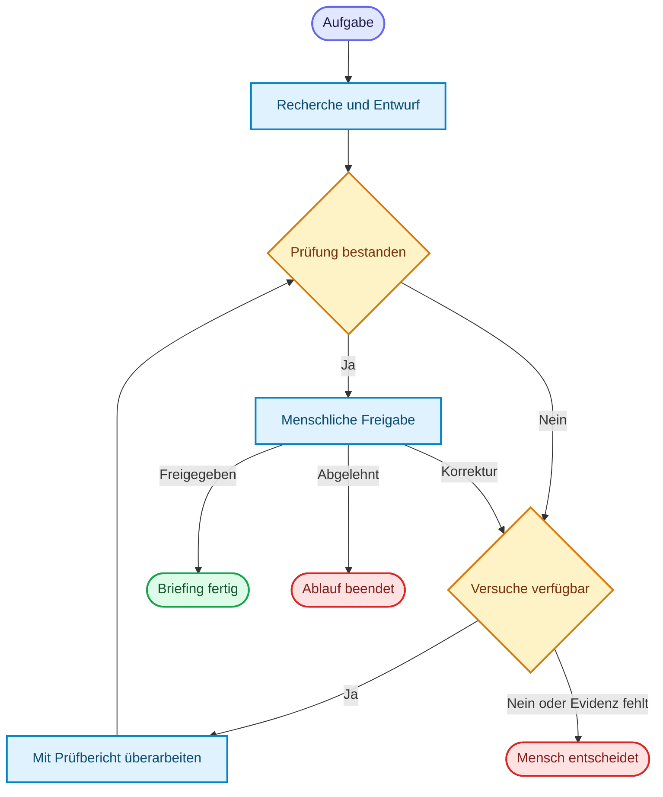

# Loop Engineering
{: .no_toc }

> **Loop Engineering gestaltet wiederholte Schritte so, dass ein Agent Fortschritt macht, Ergebnisse prüft und kontrolliert endet.**

---

# Inhaltsverzeichnis
{: .no_toc .text-delta }

1. TOC
{:toc}

---

## Warum Schleifen gestalten?

Ein Agent kann eine Aufgabe selten allein dadurch lösen, dass er einmal eine Antwort erzeugt. Er ruft ein Tool auf, beobachtet das Ergebnis und entscheidet anhand des aktualisierten Zustands über den nächsten Schritt. Diese Agentenschleife ist nützlich, wenn der Lösungsweg nicht vollständig vorgegeben ist. Sie braucht aber ein klares Ziel und Grenzen: Sonst wiederholt der Agent wirkungslose Schritte oder verbraucht unnötig Zeit und Geld.

Loop Engineering bezeichnet hier den Entwurf solcher Wiederholungen und ihrer Kontrollpunkte. Die folgende Einteilung ist eine **Orientierungshilfe**, keine allgemeingültige Taxonomie. Schleifen können ineinandergreifen, und nicht jede Aufgabe braucht alle Typen. Ist die Schrittfolge bekannt, kann ein fester Workflow einfacher und verlässlicher sein; siehe [Agenten-Architekturen]({{ '/04-agenten-implementierung/entwurf/agent-architekturen.html' | relative_url }}).

## Sieben Perspektiven auf Schleifen

| Typ | Ebene und Akteur | Aufgabe und Beispiel |
|---|---|---|
| **Orchestration Loop** | System; Supervisor oder Planer | Teilaufgaben verteilen, Ergebnisse zusammenführen und bei Bedarf den Plan ändern. Beispiel: Ein Supervisor fordert nach einem unvollständigen Rechercheergebnis eine ergänzende Suche an. |
| **Agent Loop** | Einzelner Agent; Modell und Tools | Aktion wählen, Tool-Ergebnis beobachten und den nächsten Schritt bestimmen. Beispiel: Ein PMO-Agent sucht ein Dokument und verfeinert seine Suche. |
| **Verification Loop** | Ergebnisprüfung; etwa Tests, Linter oder ein Prüfmodell | Ergebnis prüfen und bei Fehlern gezielt überarbeiten. Beispiel: Ein Code-Agent führt Tests aus und korrigiert einen gemeldeten Fehler. Deterministische Prüfungen und Modellbewertungen haben unterschiedliche Stärken und Grenzen. |
| **Safety / Guardrail Loop** | Governance; Regeln, Filter oder Prüfmodell | Eine Aktion oder Ausgabe auf Risiken prüfen, gegebenenfalls blockieren oder zur sicheren Überarbeitung zurückgeben. Ein einzelnes Gate ist bereits eine Schutzmaßnahme, aber noch keine vollständige Schleife. |
| **HITL / Collaboration Loop** | Zusammenarbeit; Mensch und Agent | Rückfragen, Freigaben und Korrekturen aufnehmen. Beispiel: Ein Mensch prüft einen Briefing-Entwurf, gibt Hinweise und erhält eine überarbeitete Fassung. |
| **Event-Driven Loop** | Laufzeit; Orchestrator und gegebenenfalls Broker | Auf externe Ereignisse oder Zeitpläne reagieren und passende Abläufe anstoßen oder fortsetzen. Checkpointing kann dabei Zustand sichern, erzeugt aber selbst keinen externen Auslöser. |
| **Learning Loop** | Verbesserung über mehrere Läufe; Team oder Offline-Pipeline | Feedback und Evaluation auswerten, etwa Beispiele oder Prompts ändern und die neue Variante erneut prüfen. Das ist nicht automatisch ein Training der Modellgewichte. |

Ein einzelner Agentenlauf kann mehrere dieser Perspektiven verbinden: Ein Supervisor startet einen Agent Loop, ein Gate prüft dessen Ergebnis und bei Bedarf folgt eine menschliche Freigabe. Der Learning Loop betrachtet dagegen die Verbesserung **über mehrere Läufe hinweg**. Er braucht kuratierte Daten und eine erneute Bewertung; gespeicherte Gesprächshistorie allein ist noch kein solcher Lernprozess.

## Eine Schleife bewusst entwerfen

Vor der Implementierung helfen diese Fragen:

1. **Ziel und Ergebnis:** Was soll erreicht werden, und woran ist ein ausreichendes Ergebnis erkennbar?
2. **Zustand:** Welche Informationen, Tool-Ergebnisse, Prüfberichte und Versuche müssen für den nächsten Schritt erhalten bleiben?
3. **Fortschritt:** Was soll sich zwischen zwei Durchläufen ändern? Ein erneuter Versuch ohne neue Information oder Korrektur wiederholt häufig nur denselben Fehler.
4. **Prüfung:** Welche Kriterien lassen sich deterministisch prüfen, und wo braucht es fachliche oder menschliche Bewertung? Ein vorhandener Quellenhinweis beweist noch nicht, dass die Quelle eine Aussage stützt.
5. **Grenzen:** Wie viele Schritte, Tool-Aufrufe, Zeit und Kosten sind höchstens zulässig? Eine technische Rekursionsgrenze ist eine zusätzliche Notbremse, ersetzt aber keine fachliche Abbruchregel.
6. **Fehler und Eskalation:** Was geschieht bei Tool-Fehlern, fehlender Evidenz oder ausgeschöpftem Budget? Wann endet der Ablauf mit einer klaren Fehlermeldung oder einer menschlichen Entscheidung?
7. **Nachvollziehbarkeit:** Welche Entscheidungen, Prüfergebnisse und Abbruchgründe müssen im Trace sichtbar sein, ohne vertrauliche Daten unnötig zu speichern?

Ein Retry bei einem vorübergehenden technischen Fehler ist von einer inhaltlichen Überarbeitung zu unterscheiden: Beide brauchen eigene Grenzen. Seiteneffekte wie das Versenden einer Nachricht dürfen bei Wiederholungen nicht versehentlich mehrfach ausgelöst werden.

## Beispiel: Ein PMO-Briefing mit begrenzter Überarbeitung

Ein PMO-Assistent soll ein Briefing aus einem Dokumentenkorpus erstellen. Der folgende Ablauf ist ein **Entwurf zur Veranschaulichung**, keine Behauptung über eine bereits vollständig implementierte Kurslösung:

1. Der Agent recherchiert im Korpus und erstellt einen Entwurf mit Quellenhinweisen.
2. Eine Prüfung kontrolliert etwa Pflichtfelder und Quellenformat. Eine fachliche Bewertung prüft, soweit möglich, ob die Aussagen tatsächlich durch die Fundstellen gestützt sind.
3. Bei konkreten Mängeln erhält der Agent den Prüfbericht und überarbeitet den Entwurf. Der Zustand speichert den Bericht und die Anzahl der Versuche.
4. Besteht der Entwurf die Prüfung, geht er zur menschlichen Freigabe. Bei Ablehnung kann die Person konkrete Korrekturen verlangen oder den Ablauf beenden.
5. Nach höchstens zwei Überarbeitungen oder bei fehlender Evidenz endet die automatische Schleife und legt den Fall mit Begründung zur menschlichen Entscheidung vor.

Die Zahl zwei ist hier eine beispielhafte Grenze. Für einen realen Anwendungsfall werden Budget, Prüfqualität und Eskalationsregeln anhand der Risiken und Evaluationsergebnisse festgelegt. Eine formale Prüfung allein garantiert keine sachliche Richtigkeit.

## Was der Kurs bereits zeigt

| Kursmodul | Beitrag zum Thema |
|---|---|
| **M10 – Tool Loop** | Tool-Schleife und ein Beispiel mit begrenztem Tool-Budget. |
| **M14 – Sessions, Checkpointing und Memory** | Zustand sichern und fortsetzen; Memory und Kontext verwalten. Ein externer Ereignistrigger ist damit nicht automatisch gegeben. |
| **M15 – Human in the Loop** | Freigabe, Ablehnung, Korrektur und Genehmigung von Tool-Aufrufen. |
| **M17 – Supervisor Pattern** | Routing zu spezialisierten Workern und Iterationsschutz. |
| **M18 – Reflection, Parallelisierung und Hierarchie** | Generator und Kritiker überarbeiten ein Ergebnis wiederholt bis zur Freigabe oder zum Limit. |
| **M20 – Agent Security Best Practices** | Sicherheitsprüfungen, Tool-Whitelist und Blockierung als einzelne Schutzbausteine. |
| **M21 – Agent Evaluation und Testing** | Deterministische Metriken und Regressionstests; eine Test-Korrektur-Schleife ist davon zu unterscheiden. |
| **M27 – Learning Loop und Agentenverbesserung** | Baseline und Variante anhand mehrerer PMO-Fälle vergleichen und eine gezielte Anweisungsänderung mit zurückgehaltenen Fällen prüfen. |

Die [Notebook-Übersicht](https://github.com/ralf-42/Agenten/blob/main/01_notebook/README.md) führt die Module und ihre Dateien auf. Ein Event-Driven Loop geht über die hier genannten Beispiele hinaus.

## Abgrenzung zu verwandten Dokumenten

| Dokument | Frage |
|---|---|
| [State Management]({{ '/04-agenten-implementierung/ablauf-zustand/state-management.html' | relative_url }}) | Welche Informationen trägt der Ablauf zwischen Schritten mit? |
| [Checkpointing & Persistenz]({{ '/04-agenten-implementierung/ablauf-zustand/checkpointing-persistenz.html' | relative_url }}) | Wie lässt sich ein unterbrochener Ablauf fortsetzen? |
| [Human-in-the-Loop]({{ '/04-agenten-implementierung/ablauf-zustand/human-in-the-loop.html' | relative_url }}) | Wie werden Freigaben und Eingriffe eingebunden? |
| [Agent Harness]({{ '/07-qualitaet-sicherheit/agent-harness.html' | relative_url }}) | Welche Laufzeit- und Kontrollmechanismen umgeben den Agenten? |
| [Evaluation & Observability]({{ '/07-qualitaet-sicherheit/evaluation-observability.html' | relative_url }}) | Wie werden Verhalten und Ergebnisse überprüft? |

---

**Version:** 1.0 
**Stand:** November 2026 
**Kurs:** KI-Agenten. Planen. Handeln. Prüfen.
