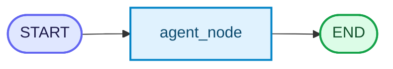
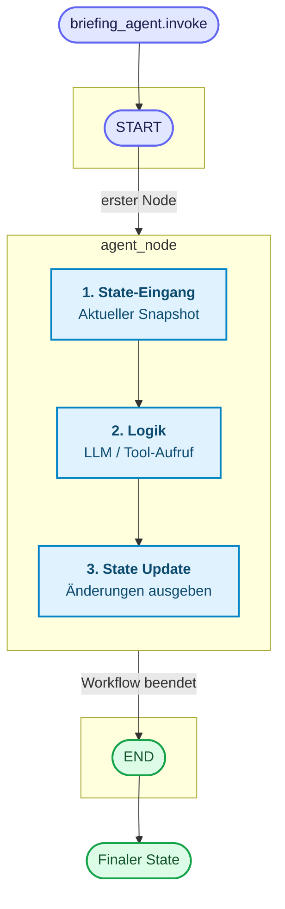
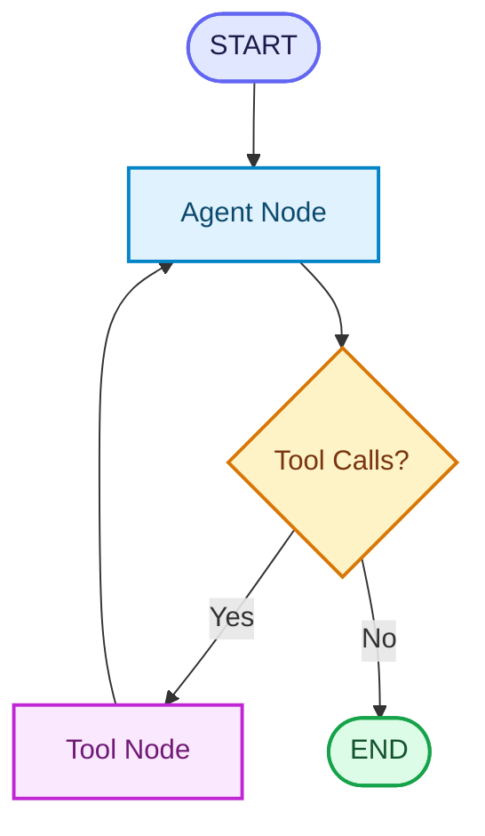
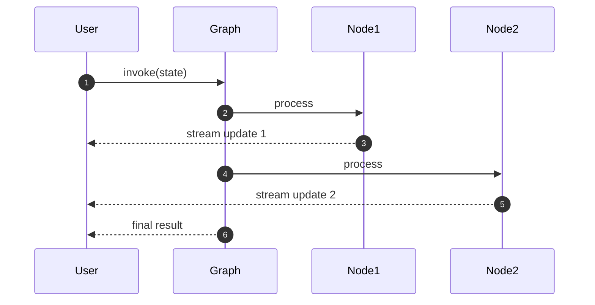
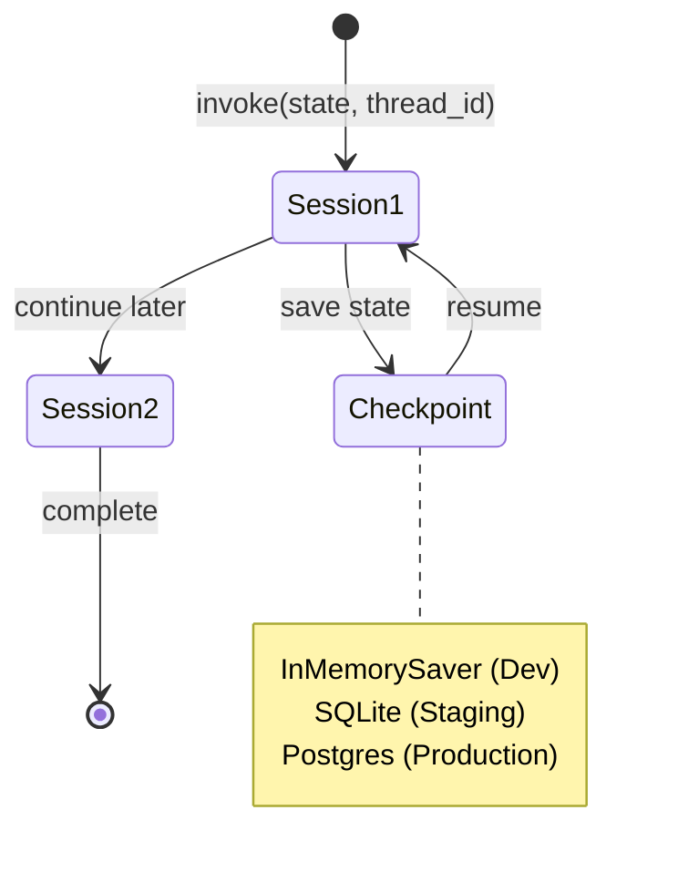
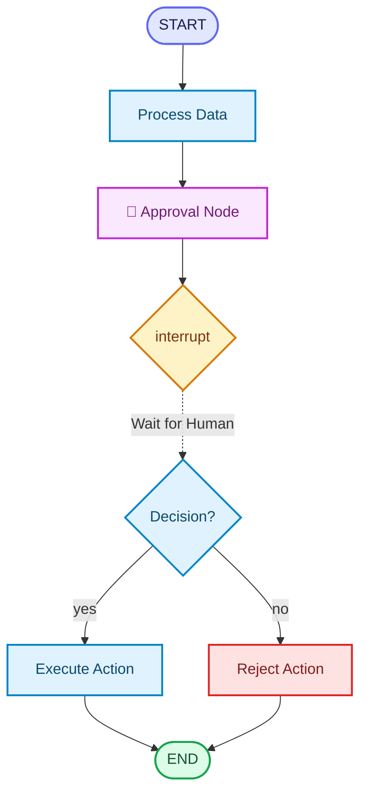
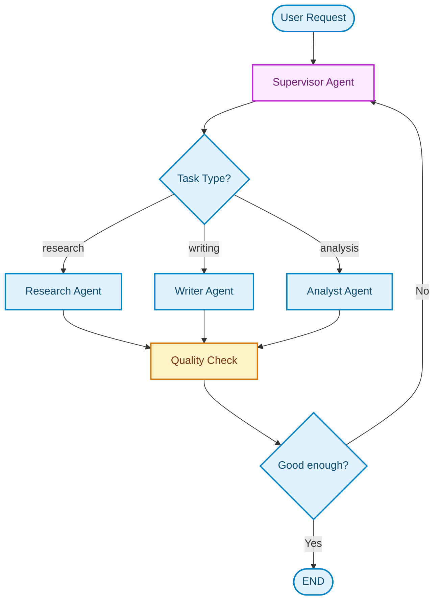

# LangGraph
{: .no_toc }

> **Multi-Agent-Systeme und Workflows mit LangGraph**

---

## Inhaltsverzeichnis
{: .no_toc .text-delta }

1. TOC
{:toc}

---

## Kurzüberblick: Warum LangGraph?

LangChain bietet Modelle, Tools und einfache Agenten. LangGraph baut darauf auf und ermöglicht:
- **Abläufe in mehreren Schritten**
- **Bedingte Entscheidungswege**
- **Mehrere Agenten (Rollen)**
- **Sitzungen, die wieder aufgenommen werden können**
- **Human-in-the-Loop**

## Lernpfad: Von einfach zu agentisch

LangGraph lernt sich am besten in kleinen Schritten. Nicht jedes Thema wird sofort gebraucht; zuerst sollten State, Nodes und Edges stabil sitzen.

| Stufe | Thema | Ziel |
|---|---|---|
| 1 | Minimaler Graph | State, Node, Edge, `START` und `END` verstehen |
| 2 | Sequenzieller Graph | lineare Workflows als Pipeline bauen |
| 3 | Conditional Routing | Entscheidungen in Code statt im Prompt modellieren |
| 4 | Loop / Retry | Wiederholungen mit klarer Exit-Bedingung bauen |
| 5 | Tool-Loop | LLM-Entscheidung, Tool-Ausführung und Antwort verbinden |
| 6 | Streaming | Zwischenschritte sichtbar machen |
| 7 | Checkpointing | Sessions wiederaufnehmen und lange Abläufe absichern |
| 8 | Human-in-the-Loop | Freigaben und Korrekturen technisch erzwingen |
| 9 | Subgraphs / Multi-Agent | größere Workflows modularisieren |
| 10 | Agentic RAG | Retrieval, Tools und Routing in einem Graph kombinieren |


---

## Zentrale Konzepte

| Konzept | Bedeutung |
|---|---|
| State | Gemeinsamer Zustand, der durch den Workflow wandert |
| Node | Ein einzelner Bearbeitungsschritt |
| Edge | Verbindung zwischen Schritten |
| Conditional Routing | Entscheidung, welcher Pfad als Nächstes läuft |
| Checkpointing | Speichert Zustand für Resume und Debugging |
| Interrupt | Technischer Halt für Human-in-the-Loop |

Interaktive Demo: [LangGraph – Interaktiver Explainer]({{ '/visualisierungen/langgraph_explainer/' | relative_url }}){:target="_blank" rel="noopener"} – macht State, Nodes, Edges und bedingtes Routing schrittweise erlebbar.

---

## Quickstart

Der schnellste Weg zum Verständnis ist ein Mini-Workflow.

Ein Workflow besteht aus:
- **State:** zentrale Daten
- **Nodes:** Bearbeitungsschritte
- **Edges:** Ablaufsteuerung

### State definieren

```python
from typing import TypedDict, Annotated
from langgraph.graph.message import add_messages

class BriefingState(TypedDict):
    messages: Annotated[list, add_messages]
    step: int
```

### Ein einzelner Node

```python
from langchain.chat_models import init_chat_model
llm = init_chat_model("openai:gpt-6-luna")

def agent_node(state: BriefingState) -> dict:
    response = llm.invoke(state["messages"])
    return {"messages": [response], "step": state["step"] + 1}
```

### Graph bauen

```python
from langgraph.graph import StateGraph, START, END

briefing_builder = StateGraph(BriefingState)
briefing_builder.add_node("agent", agent_node)
briefing_builder.add_edge(START, "agent")
briefing_builder.add_edge("agent", END)

briefing_agent = briefing_builder.compile()
```

### Graphen visualisieren

```python
from IPython.display import Image

display(Image(briefing_agent.get_graph(xray=True).draw_mermaid_png()))
```

Dieser minimale Workflow sieht so aus:



### Ausführen

```python
from langchain_core.messages import HumanMessage

initial_state = {"messages": [HumanMessage(content="Was ist LangGraph?")], "step": 0}
result = briefing_agent.invoke(initial_state)
result
```

**Ergebnis:** Ein vollständiger erster Workflow, bevor irgendein abstraktes Konzept erklärt wurde.

---

## Grundaufbau: Workflows als State Machine

Nach einem ersten funktionsfähiges Beispiel, kann das Konzept erklärt werden:

- Ein Workflow besteht aus klar definierten Schritten (*Nodes*).
- Der Zustand wird in einem *State* gespeichert.
- *Edges* bestimmen die Reihenfolge.
- *Reducer* wie `add_messages` fügen Informationen intelligent zusammen.



Kurz: **Nodes sind Funktionen – Edges sind der Ablauf.**

---

## State sauber definieren (vertieft)

```python
class BriefingState(TypedDict):
    messages: Annotated[list, add_messages]
    step: int
    # erweiterbar: approved: bool, analysis: str
```

Prinzipien:
- Nur speichern, was später benötigt wird.
- Typisierung unterstützt Verständnis und Fehlersuche.
- Reducer sorgen dafür, dass Listen (z. B. Nachrichten) korrekt gemergt werden.

---

## Nodes: Bausteine des Workflows

Nodes sollen klein, fokussiert und deterministisch sein.

**Ein Node ist immer eine Python-Funktion** — was sich unterscheidet, ist der Inhalt:

| Node-Typ | Inhalt der Funktion | Typischer Einsatz |
|---|---|---|
| **LLM-Node** | direkter LLM-Aufruf | Antworten, Zusammenfassungen |
| **Tool-Node** | Tool-Ausführung | Suche, Berechnungen, APIs |
| **Agent-Node** | vollständiger Agent (`create_agent`) | komplexe Teilaufgaben mit eigenem Tool-Loop |

### Typ 1: LLM-Node

```python
def summarize_node(state: BriefingState) -> dict:
    text = "\n".join([m.content for m in state["messages"]])
    summary = llm.invoke([{"role": "human", "content": f"Fasse zusammen: {text}"}])
    return {"messages": [summary]}
```

### Typ 2: Tool-Node

```python
from langchain_core.tools import tool
from langchain_core.messages import AIMessage

@tool
def suche(query: str) -> str:
    """Durchsucht die Projektdokumente."""
    return f"Ergebnis für: {query}"

def tool_node(state: BriefingState) -> dict:
    result = suche.invoke({"query": state["messages"][-1].content})
    return {"messages": [AIMessage(content=result)]}
```

### Typ 3: Agent-Node

Ein Node kann intern einen vollständigen Agenten ausführen — inklusive eigenem Tool-Loop:

```python
from langchain.agents import create_agent

research_agent = create_agent(
    model=llm,
    tools=[suche],
    system_prompt="Du bist ein Spezialist für Projektrecherche. Belege jede Aussage mit einer Quelle.",
)

def research_node(state: BriefingState) -> dict:
    result = research_agent.invoke({"messages": state["messages"]})
    return {"messages": result["messages"]}
```

> **Hinweis:** Der Agent-Node ist das Muster hinter Supervisor-Architekturen (Multi-Agent Patterns, Supervisor Pattern). Der Supervisor ruft `research_node`, `writer_node` etc. auf — jeder Node kapselt intern einen vollständigen Agenten.

---

## Typische Workflows

Die folgenden Abschnitte zeigen die wichtigsten Einsteiger-Workflows: lineare Graphen, bedingtes Routing, Streaming, Sessions, Human-in-the-Loop und einfache Multi-Agent-Muster.

---

## Edges & Conditional Routing

Nun erst wird Routing eingeführt – **nachdem Entwickler Nodes und State kennen**.

### Lineare Edges

```python
briefing_builder.add_edge(START, "agent")
briefing_builder.add_edge("agent", END)
```

### Bedingtes Routing

```python
def tool_node(state: BriefingState):
    result_message = ...  # echtes Tool
    return {"messages": [result_message]}

def router(state: BriefingState) -> str:
    last_msg = state["messages"][-1]
    if getattr(last_msg, "tool_calls", None):
        return "tools"
    return END
```

```python
briefing_builder.add_node("tools", tool_node)
briefing_builder.add_conditional_edges(
    "agent",
    router,
    {"tools": "tools", END: END},
)
briefing_builder.add_edge("tools", "agent")
briefing_agent = briefing_builder.compile()
```

**Visualisierung des Tool-Loops:**



### Typische Muster
- Schlüsselwort-Trigger
- Unsicherheitsanalyse
- Routing nach Tool-Feedback
- Wiederholschleifen (Retry)

### State ändern und gleichzeitig routen: `Command`

Wenn ein Schritt den State aktualisieren soll und gleichzeitig bestimmt, wohin als Nächstes gegangen wird, ist `Command(update=..., goto=...)` das passende Muster.

```python
from typing import Literal
from langgraph.types import Command

def classify_node(state: BriefingState) -> Command[Literal["tools", "answer"]]:
    if "suche" in state["messages"][-1].content.lower():
        return Command(update={"step": state["step"] + 1}, goto="tools")
    return Command(update={"step": state["step"] + 1}, goto="answer")
```

Für Einsteiger gilt: Nutze erst einfache Verzweigungen mit `add_conditional_edges()`. `Command` lohnt sich besonders dann, wenn Update und Routing fachlich zusammengehören.

---

## Streaming: Schritte sichtbar machen

Streaming ist ein wichtiges Werkzeug für das Verständnis.

```python
config = {"configurable": {"thread_id": "demo"}}

for chunk in briefing_agent.stream(
    initial_state,
    config=config,
    stream_mode="updates",
    version="v2",
):
    if chunk["type"] == "updates":
        print(chunk["data"])
```

**Streaming-Prozess:**



Streaming-Varianten:
- `updates`: nur Änderungen
- `values`: vollständiger State
- `messages`: nur neue Nachrichten
- `debug`: detaillierte Ausführungsinformationen

Empfehlung: **updates**.

**Tipp für später:** Ab LangGraph v1.2 gibt es zusätzlich `stream_events(version="v3")` mit getrennten Kanälen (`run.values`, `run.messages`, `run.lifecycle`, `run.subgraphs`). Die v3-API ist experimentell und kann sich ändern; für den Einstieg reicht `stream(..., stream_mode=...)` aus. [LangGraph-Referenz: `stream_events`](https://reference.langchain.com/python/langgraph/pregel/main/Pregel/stream_events)

---

## Checkpointing & Sessions

Checkpointing ermöglicht:
- längerfristige Workflows
- Resume nach Unterbrechung
- stabile Interaktion

```python
from langgraph.checkpoint.memory import InMemorySaver
checkpointer = InMemorySaver()
briefing_agent = briefing_builder.compile(checkpointer=checkpointer)

config = {"configurable": {"thread_id": "session-01"}}
result1 = briefing_agent.invoke(initial_state, config)
```

Später:

```python
new_input = {
    "messages": [HumanMessage(content="Fahre mit der nächsten Frage fort.")],
    "step": 0,
}
result2 = briefing_agent.invoke(new_input, config)
```

Checkpointing lädt dabei den gespeicherten Zustand der `thread_id` und ergänzt ihn um den neuen Input. Für Human-in-the-Loop-Unterbrechungen wird dagegen nicht ein neuer State übergeben, sondern `Command(resume=...)`.

**Session-Management mit Checkpointing:**



Hinweise:
- Optimale Einstiegsvariante: InMemorySaver.
- Für produktive Systeme: SQLite/Postgres.
- Graphänderungen können Sessions invalidieren.

---

## Human-in-the-Loop (Approval & Formulare)

Human-in-the-Loop ist ein wichtiges Konzept – aber erst an dieser Stelle sinnvoll.

### Interrupt

```python
from typing import TypedDict

from langgraph.checkpoint.memory import InMemorySaver
from langgraph.graph import END, START, StateGraph
from langgraph.types import Command, interrupt


class ApprovalState(TypedDict):
    draft: str
    approved: bool


def approval_node(state: ApprovalState) -> dict:
    decision = interrupt({"draft": state["draft"], "question": "Freigeben? yes/no"})
    return {"approved": decision == "yes"}


approval_builder = StateGraph(ApprovalState)
approval_builder.add_node("approval_node", approval_node)
approval_builder.add_edge(START, "approval_node")
approval_builder.add_edge("approval_node", END)
approval_agent = approval_builder.compile(checkpointer=InMemorySaver())

approval_config = {"configurable": {"thread_id": "approval-001"}}
approval_agent.invoke(
    {"draft": "Vorgang freigeben", "approved": False},
    config=approval_config,
)
```

### Weiterführen

```python
result = approval_agent.invoke(
    Command(resume="yes"),
    config=approval_config,
)
```

Der Checkpointer hält den unterbrochenen Zustand. Zum Fortsetzen verwendet der Lauf dieselbe thread_id.

**Human-in-the-Loop Pattern:**



Einsatzmöglichkeiten:
- sicherheitsrelevante Aktionen
- wichtige Entscheidungen
- mehrschrittige Formulareingaben

---

## Multi-Agent-Workflows (Fortgeschritten)

Dieses Thema wurde bewusst ans Ende verschoben.

### Agenten definieren

```python
from langchain.agents import create_agent

research_agent = create_agent(model=llm, tools=[...], system_prompt="Research")
writer_agent   = create_agent(model=llm, tools=[...], system_prompt="Writer")
```

### Supervisor

```python
from langgraph.types import Command

def supervisor(state: BriefingState) -> Command:
    task = state.get("task_type", "research")
    return Command(goto=f"{task}_agent")
```

**Multi-Agent Supervisor Pattern:**



Mögliche Erweiterungen:
- iterative Qualitätsprüfungen
- mehrere Worker mit Prioritäten
- automatische oder manuelle Rollenwechsel

---

## Best Practices

- State klein und explizit halten.
- Nodes nach fachlicher Verantwortung trennen.
- Routing als Funktion modellieren statt in Prompt-Text zu verstecken.
- Graph nach dem Kompilieren visualisieren.
- Checkpointing einsetzen, sobald Sessions wiederaufgenommen werden sollen.
- Human-in-the-Loop technisch mit Interrupts erzwingen.

---

## Troubleshooting

### Graph endet zu früh

Prüfe die Edges und Rückgabewerte der Routing-Funktion. Jeder mögliche Rückgabewert muss auf einen gültigen Zielknoten oder `END` zeigen.

### State wird überschrieben

Nutze Reducer wie `add_messages`, wenn Listen über mehrere Schritte erweitert statt ersetzt werden sollen.

### Human-in-the-Loop läuft nicht weiter

Setze eine stabile `thread_id` und verwende `Command(resume=...)`, um nach einem Interrupt fortzufahren.

---

## Erweiterungen / Fortgeschrittene Themen

### Ausblick auf Best Practices

Diese Konzepte gehören nicht in den ersten Minimalgraph, erklären aber die produktionsnähere LangGraph-Dokumentation:

| Konzept | Kurz erklärt |
|---|---|
| Persistenter Store und Löschkonzept | Checkpointing speichert Zustand. Sobald Daten dauerhaft gespeichert werden, muss klar sein, was nur zur Session gehört, was langfristig bleibt und wie sensible Daten gelöscht werden. Beim `PostgresSaver` räumt `prune(thread_ids, strategy="keep_latest")` alte Checkpoints einer Session auf, `strategy="delete"` entfernt sie komplett. |
| `ToolRuntime` | Tools können bei Bedarf Laufzeitkontext erhalten, etwa `thread_id`, Store, Stream Writer oder Konfiguration. Für einfache Tools bleibt ein normaler Funktionsparameter aber verständlicher. |
| Robustheit für Production (v1.2.0) | Node-Timeouts (`timeout=` in `add_node()`), Node-Level Error-Handler (`error_handler=`) und Graceful Shutdown (`RunControl.request_drain()`) sorgen dafür, dass einzelne Nodes nicht den ganzen Graph blockieren oder abstürzen lassen. |

---

- Checkpointing über persistente Stores
- Human-in-the-Loop mit Formularen
- Multi-Agent-Workflows
- LangSmith-Tracing für Graph-Runs

---

## Zusammenfassung

LangGraph wird dann sinnvoll, wenn ein LLM-Workflow echten Zustand, Routing oder Unterbrechungen braucht. Der Einstieg gelingt am besten über den minimalen Graph aus State, Node und Edge; danach kommen Conditional Routing, Streaming, Checkpointing und Human-in-the-Loop hinzu.

---

## Abgrenzung zu verwandten Dokumenten

| Dokument | Inhalt |
|---|---|
| [LangChain Einsteiger](einsteiger-langchain.html) | Voraussetzung: Modell-Init, Tools und Agenten mit LangChain |
| [ChromaDB Einsteiger](einsteiger-chromadb.html) | Vektordatenbank als RAG-Tool in LangGraph-Workflows |


---

**Version:** 2.2<br>
**Stand:** Oktober 2026<br>
**Kurs:** KI-Agenten. Planen. Handeln. Prüfen.

