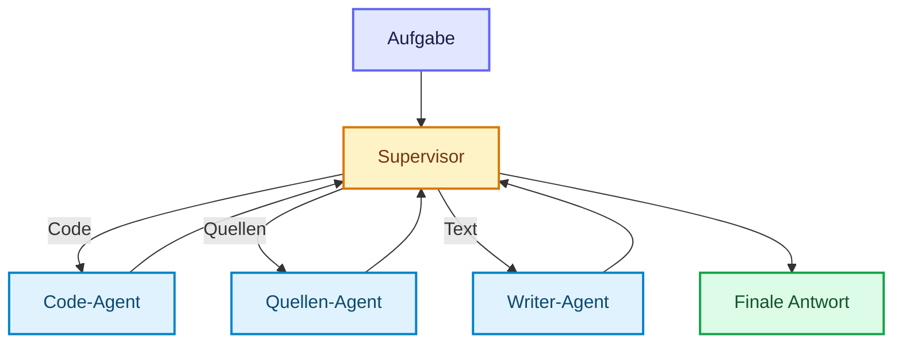
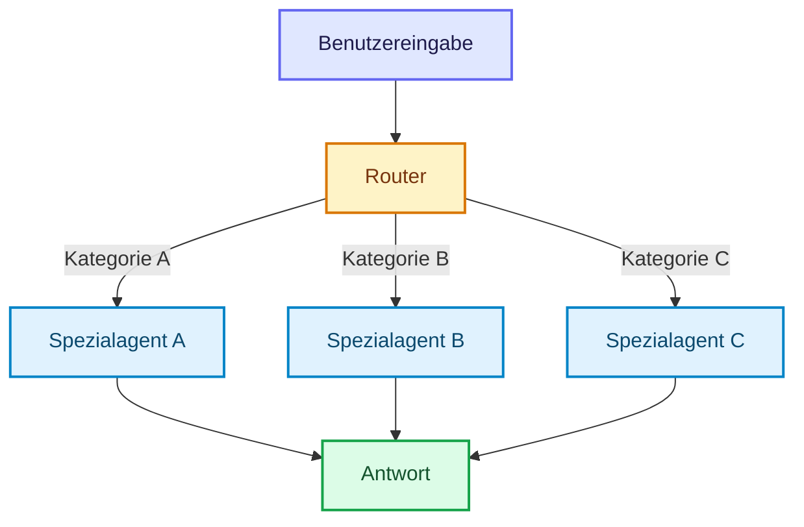
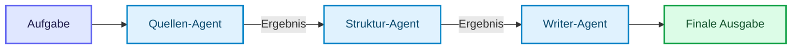
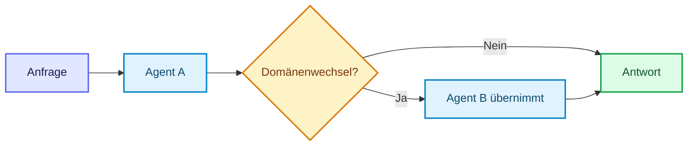
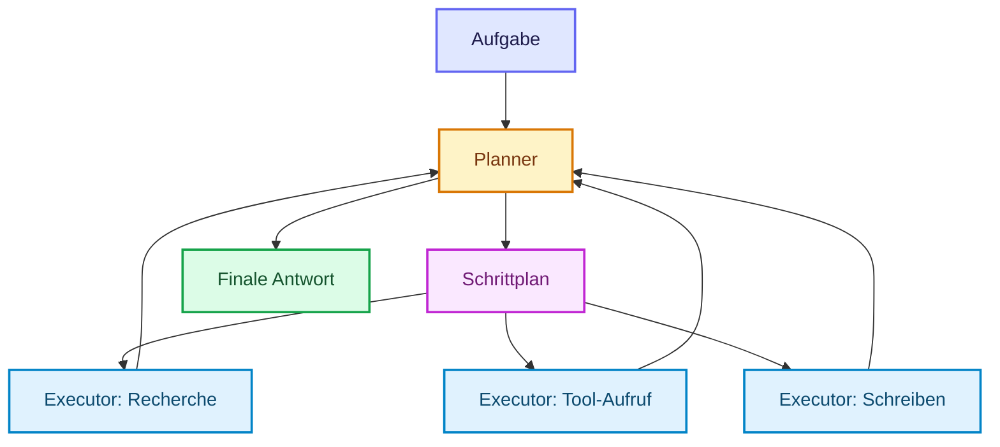
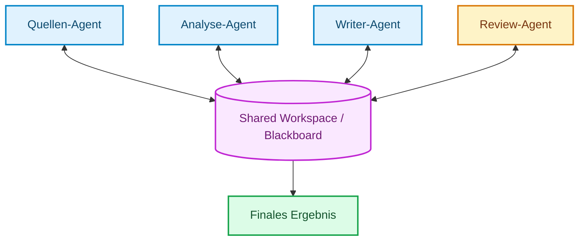
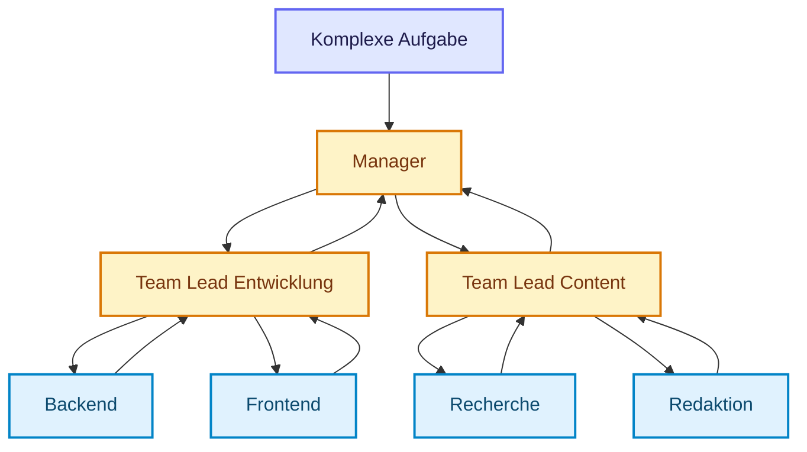
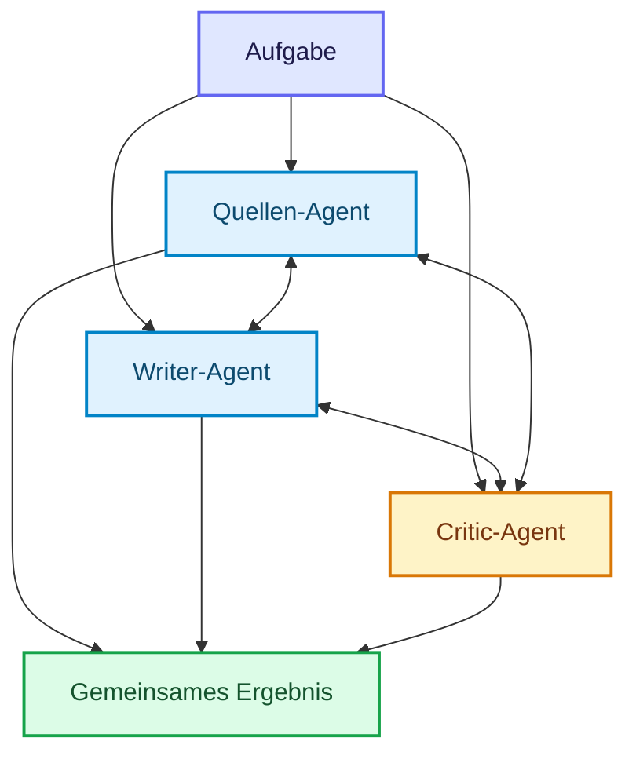
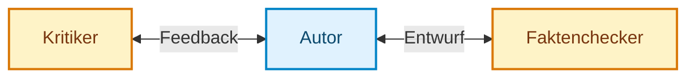
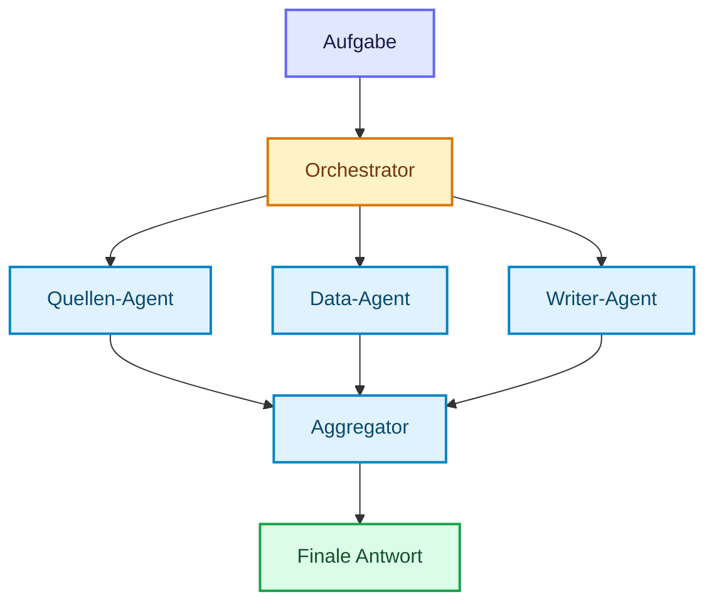

# Multi-Agent-Systeme
{: .no_toc }

> **Mehrere Agenten lohnen sich erst dann, wenn echte Spezialisierung einen erkennbaren Gewinn bringt.**

---

# Inhaltsverzeichnis
{: .no_toc .text-delta }

1. TOC
{:toc}

---

## Warum Multi-Agent nicht automatisch besser ist

Sobald ein einzelner Agent komplexe Aufgaben bearbeiten soll, entsteht schnell der Gedanke, die Arbeit auf mehrere spezialisierte Agenten zu verteilen. Das kann sinnvoll sein. Es kann aber auch unnötige Komplexität erzeugen. Multi-Agent-Systeme sind deshalb keine automatische Weiterentwicklung eines Einzelagenten. Sie sind eine Architekturentscheidung, die sich begründen lassen muss.

Multi-Agent-Systeme teilen Arbeit auf und ermöglichen Spezialisierung oder Parallelität. Sie kosten zusätzliche Koordination, State und Debugging-Aufwand. Prüfe deshalb zuerst, ob ein einzelner Workflow mit klaren Knoten die Aufgabe schon abdeckt.

**Typischer Fehler:** Multi-Agent zu wählen, weil es moderner oder „agentischer” klingt, obwohl ein sauberer Workflow denselben Fall einfacher lösen würde.

Konkret scheitert ein einzelner Agent typischerweise an einer von drei strukturellen Grenzen:

| Grenze | Ursache | Wann Multi-Agent hilft |
|---|---|---|
| Context Exhaustion | Aufgabe übersteigt das verfügbare Kontextfenster | Kontext aufteilen, jeder Agent verwaltet seinen Teil |
| Spezialisierung vs. Generalisierung | Ein Generalist trifft Fachentscheidungen schlechter als ein Spezialist | Separate Rollen mit fokussiertem Prompt und Fachtiefe |
| Parallelisierungsgrenze | Unabhängige Teilaufgaben laufen trotzdem sequenziell | Mehrere Agenten arbeiten gleichzeitig an unabhängigen Paketen |

Multi-Agent lohnt sich, wenn mindestens einer dieser Punkte zum echten Engpass wird.

## Ein einfaches Beispiel

Ein System soll einen Statusbericht für den Steuerkreis erstellen. Eine Person oder ein einzelner Agent müsste recherchieren, ordnen, formulieren und prüfen. In einem Multi-Agent-System kann ein Quellen-Agent Quellen sammeln, ein Schreib-Agent den Bericht formulieren und ein Review-Agent auf Konsistenz und Qualität prüfen.

Dieses Beispiel zeigt den eigentlichen Nutzen: Nicht mehrere Agenten um ihrer selbst willen, sondern klar unterscheidbare Rollen mit echter Arbeitsteilung.

## Welche Grundmuster es gibt

Multi-Agent-Systeme unterscheiden sich weniger durch die Zahl der Agenten als durch ihre Koordination. Die folgenden Muster decken die gängigen Fälle ab:

| Muster | Steuerungslogik | Stärke | Hauptrisiko |
|---|---|---|---|
| Supervisor | zentrale Rolle verteilt Aufgaben an Worker | gute Kontrolle und Zusammenführung | Supervisor wird Engpass |
| Router | Klassifikation am Eingang | schnell und kostengünstig | falsches Routing |
| Pipeline | Ergebnisse fließen sequenziell von Agent zu Agent | robust und gut testbar | wenig flexibel |
| Handoff | Zuständigkeit wechselt während der Bearbeitung | flexibel bei wechselnden Zuständigkeiten | unklare Verantwortung |
| Skill-orientiert | ein Agent lädt Fähigkeiten nach Bedarf | modular ohne volles Agententeam | Agent wird zu breit |
| Planner-Executor | Planen und Ausführen getrennt | prüfbare Schritte | starrer Plan |
| Blackboard | gemeinsamer Arbeitsbereich | gute Zusammenarbeit an Artefakten | ungeordneter State |
| Swarm / Peer-to-Peer | gleichberechtigte Agenten koordinieren sich | viele Perspektiven | schwer zu kontrollieren |
| Hierarchisch | mehrere Ebenen aus Leitrollen und Workern | skalierbar für große Teams | hoher Koordinationsaufwand |
| Kollaborativ | Agenten arbeiten direkt mit Feedbackschleifen zusammen | gute Qualität durch Gegenlesen | Endlosschleifen |
| Debate / Critique | getrennte Lösungen werden gegeneinander geprüft | starke Qualitätsprüfung | hoher Overhead |
| Parallel | unabhängige Teilaufgaben laufen gleichzeitig | schneller bei unabhängigen Paketen | Scheinparallelität |

Als Leitfrage dient, wo Verantwortung, Übergabe und Prüfung am klarsten bleiben. Wie modern ein Muster klingt, spielt keine Rolle.

## Supervisor: der naheliegende Einstieg

Das Supervisor-Pattern ist der naheliegende Einstieg, wenn eine zentrale Stelle Aufgaben an spezialisierte Worker verteilen soll. Ein zentraler Supervisor erhält die Aufgabe, bewertet sie und delegiert an einen passenden Spezialisten.



Der Vorteil liegt in klaren Verantwortlichkeiten. Der Nachteil ist, dass der Supervisor schnell zum Engpass wird, wenn er neben dem Routing auch selbst die Facharbeit übernimmt.

```python
class TeamState(TypedDict):
    messages: Annotated[list, add_messages]
    next_worker: str
    task_complete: bool

def supervisor_node(state: TeamState) -> Command:
    last_message = state["messages"][-1].content.lower()
    if "code" in last_message:
        return Command(goto="code_agent")
    if "quellen" in last_message:
        return Command(goto="quellen_agent")
    return Command(goto="writer_agent")
```

Ein Supervisor eignet sich, wenn Aufgaben vorab klar klassifiziert und getrennten Rollen zugewiesen werden können.

**Entscheide so:** Nimm Supervisor, wenn eine zentrale Rolle den Überblick halten und mehrere Teilergebnisse zu einer Antwort zusammenführen muss.

## Router: wenn die Kategorie am Anfang entscheidet

Router sind sinnvoll, wenn Anfragen früh klassifiziert und dann an den passenden Spezialisten weitergeleitet werden können. Der Router entscheidet lediglich, welcher Agent zuständig ist, und bearbeitet die Aufgabe nicht selbst.



Der Vorteil liegt in geringer Latenz und klarer Zuständigkeit: Nur der passende Spezialagent wird aktiv. Das Muster ist aber empfindlich gegen falsche Klassifikation. Wenn der Router am Anfang falsch entscheidet, läuft die gesamte Bearbeitung in die falsche Richtung.

**Entscheide so:** Nimm Router, wenn die Eingaben zuverlässig in wenige Kategorien fallen und jede Kategorie eine klar andere Bearbeitung braucht.

## Pipeline: wenn Ergebnisse sequenziell weitergereicht werden

Das Pipeline-Muster eignet sich, wenn Aufgaben in fester Reihenfolge voneinander abhängen und das Ergebnis eines Agents direkt die Eingabe des nächsten bildet.



Der Unterschied zum Supervisor: Es gibt keine zentrale Routing-Logik. Jeder Agent gibt sein Ergebnis direkt weiter, ohne dass eine übergeordnete Stelle steuert.

Ein zentrales Designproblem dabei ist Context Compression. Spätere Agenten erhalten eine komprimierte Übergabe statt der vollständigen Bearbeitungsgeschichte. Das spart Kontext, bringt aber einen Fidelity-Tradeoff mit sich: Details, die im Ursprungsmaterial stecken, können auf dem Weg verloren gehen. Diese Entscheidung sollte bewusst getroffen werden.

Eine Pipeline passt zu fest definierten Schritten, deren Ergebnisse nacheinander weitergegeben werden. Für dynamische Umverteilung ist ein anderes Muster geeigneter.

**Entscheide so:** Nimm Pipeline, wenn die fachliche Reihenfolge stabil ist und jede Stufe ein prüfbares Zwischenergebnis liefert.

## Handoff: wenn sich die Zuständigkeit erst unterwegs zeigt

Nicht immer ist die richtige Rolle schon am Anfang klar. Manchmal beginnt ein allgemeiner Agent mit einer Anfrage und erkennt erst während der Bearbeitung, dass eine andere Spezialisierung nötig ist. Genau dann passt das Handoff-Pattern.



Hier entscheidet der bearbeitende Agent selbst, ein externer Router greift vorab nicht ein. Das macht das System flexibler, erfordert aber sauberen Kontexttransfer.

**Typischer Fehler:** Beim Handoff den bisherigen Kontext nicht vollständig zu übergeben. Dann beginnt der übernehmende Agent praktisch blind.

Eine strukturierte Übergabe trennt das Arbeitsergebnis vom Denkweg: Das Ergebnis (`result_summary`, `artifacts`) geht immer weiter, der vollständige Reasoning Trace (`reasoning_trace`) nur dann, wenn der übernehmende Agent ihn tatsächlich braucht. Diese Trennung hält den Kontext des nächsten Agents schlank.

**Entscheide so:** Nimm Handoff, wenn die richtige Zuständigkeit erst während der Bearbeitung sichtbar wird und der Kontext sauber übergeben werden kann.

## Skill- oder Capability-Loading statt dauerhaftem Spezialistentrupp

Manche Systeme brauchen kein volles Multi-Agent-Team, sondern nur einen Hauptagenten, der gezielt zusätzliche Fähigkeiten lädt. Dieses Muster ist besonders dann interessant, wenn Fachwissen umfangreich, aber nur sporadisch benötigt wird. Es verhindert Prompt Bloat und hält den aktiven Kontext schlanker.

```python
SKILL_REGISTRY = {
    "legal": [vertrag_pruefen, dsgvo_check],
    "finance": [budget_analysieren],
    "general": [],
}
```

**Grenze:** Dieses Muster ist keine echte arbeitsteilige Mehragenten-Koordination, sondern eher ein fokussierter Hauptagent mit temporären Capability-Sets.

**Entscheide so:** Nimm Skills, wenn ein einzelner Agent verantwortlich bleiben soll, aber zeitweise anderes Fachwissen oder andere Werkzeuge braucht.

## Planner-Executor: wenn der Plan sichtbar sein soll

Beim Planner-Executor-Muster erzeugt ein Planungsagent zuerst eine Aufgabenliste. Ein oder mehrere Executor-Agenten oder Tools arbeiten diese Schritte danach ab. Der Planner macht den Lösungsweg sichtbar, legt aber nicht jedes Ausführungsdetail fest.



Der Nutzen liegt in der Prüfbarkeit. Ein Plan kann angezeigt, bewertet oder freigegeben werden, bevor riskante Aktionen laufen. Problematisch wird das Muster, wenn der Plan zu früh festgeschrieben wird und neue Beobachtungen nicht mehr zurückfließen.

**Entscheide so:** Nimm Planner-Executor, wenn mehrstufige Arbeit sichtbar, prüfbar oder freigabepflichtig sein soll.

## Blackboard: wenn alle an einem Artefakt arbeiten

Beim Blackboard-Muster kommunizieren Agenten nicht primär direkt miteinander. Sie lesen und schreiben in einen gemeinsamen Arbeitsbereich: Quellen, Notizen, Entwürfe, offene Fragen oder Statusinformationen.



Dieses Muster passt gut, wenn mehrere Agenten an demselben Artefakt arbeiten: einem Briefing, einem Bericht, einer Tabelle oder einem Plan. Der gemeinsame State braucht aber Pflege. Ohne Statusfelder, Quellenangaben und klare Schreibregeln wächst das Blackboard schnell unkontrolliert.

**Entscheide so:** Nimm Blackboard, wenn Zwischenergebnisse sichtbar geteilt werden sollen und der gemeinsame Arbeitsstand wichtiger ist als direkte Übergaben.

## Hierarchische Systeme für größere Teams

Wenn ein Supervisor nicht mehr ausreicht, kann eine Hierarchie aus Leitrollen und Unterteams sinnvoll werden. Ein Manager verteilt Teilbereiche an Team Leads, diese koordinieren wiederum ihre eigenen Worker.



Dieses Muster lohnt sich erst, wenn Anzahl der Rollen, Aufgabenkomplexität und Abhängigkeiten hoch genug sind. Für kleine Demo- oder Proof-of-Concept-Setups ist es meist schon die zweite oder dritte Ausbaustufe, nicht der Startpunkt.

**Entscheide so:** Nimm Hierarchie erst, wenn ein einzelner Supervisor zu breit wird und mehrere Unterteams wirklich eigene Verantwortung brauchen.

## Swarm / Peer-to-Peer: wenn keine zentrale Rolle führen soll

Bei Swarm- oder Peer-to-Peer-Architekturen arbeiten mehrere Agenten ohne festen Supervisor zusammen. Jeder Agent kann Beiträge liefern, andere Agenten anstoßen oder auf neue Informationen reagieren. Die Koordination entsteht durch Regeln, gemeinsamen State oder ein Kommunikationsprotokoll.



Das Muster ist flexibel, aber schwerer zu kontrollieren als Supervisor, Pipeline oder Blackboard. Ohne klare Regeln entstehen leicht doppelte Arbeit, widersprüchliche Entscheidungen und hohe Kosten.

**Entscheide so:** Nimm Swarm nur, wenn gleichberechtigte Perspektiven wirklich gebraucht werden und Kontrollregeln für Kosten, Abbruch und Ergebniszusammenführung existieren.

## Kollaboration und Review-Schleifen

Ein anderes Muster entsteht, wenn Agenten einander aktiv bewerten oder überarbeiten, statt nur Aufträge weiterzureichen. Ein typischer Fall ist ein Autor-Kritiker-Zyklus.



Diese Form kann Qualität deutlich erhöhen, birgt aber das Risiko von Endlosschleifen oder instabilen Iterationen. Deshalb braucht sie klare Abbruchbedingungen und Iterationsgrenzen.

**Entscheide so:** Nimm Review-Schleifen, wenn Qualität durch Gegenlesen, Kritik oder Faktenprüfung besser wird und die Zahl der Iterationen begrenzt ist.

## Debate und Critique: wenn Widerspruch die Qualität sichert

Das Debate-Muster geht weiter als einfache Feedback-Schleifen. Zwei unabhängige Agenten erarbeiten getrennte Lösungen, ein dritter bewertet und entscheidet.

Die Rollen: Ein Proposer liefert die erste Lösung. Ein Challenger erarbeitet eine alternative Sichtweise oder sucht systematisch nach Schwachstellen. Ein Adjudicator vergleicht beide und trifft die finale Entscheidung. Das Ergebnis enthält einen Agreement-Level (HIGH, MEDIUM, LOW, CONTRADICTION). Bei CONTRADICTION ist menschliche Überprüfung angebracht.

Geeignet für komplexe Entscheidungen, bei denen ein einzelner Entwurf systematisch blind für eigene Fehler ist. Nicht geeignet für einfache, klar definierte Aufgaben — dort erzeugt Debate nur unnötigen Overhead.

**Entscheide so:** Nimm Debate nur, wenn echte Gegensicht nötig ist und der zusätzliche Aufwand durch bessere Entscheidungen gerechtfertigt wird.

## Parallelität lohnt sich nur bei unabhängigen Teilaufgaben

Parallelität ist ein eigener Gewinn von Multi-Agent-Systemen, aber nur dann, wenn Teilaufgaben wirklich unabhängig voneinander bearbeitet werden können. Recherchen in mehreren Quellen, parallele Dokumentanalysen oder Arbeitspakete ohne gegenseitige Abhängigkeit sind gute Kandidaten.



Nicht geeignet, wenn: Schritt B inhaltlich vom Ergebnis aus Schritt A abhängt. Dann ist eine scheinbar parallele Architektur nur komplizierter, aber nicht schneller.

**Entscheide so:** Nimm Parallelität nur bei unabhängigen Teilaufgaben. Sobald Ergebnisse voneinander abhängen, ist Pipeline oder Workflow meist ehrlicher.

## Kommunikation und gemeinsamer State

In LangGraph erfolgt Zusammenarbeit meist über Shared State. Jeder Agent liest aus demselben oder aus kompatiblen State-Strukturen und gibt gezielt Änderungen zurück. Alternativ sind direkte Aufrufe oder asynchrone Nachrichten möglich, aber als Standardmodell dient Shared State.

```python
class MultiAgentState(TypedDict):
    messages: Annotated[list, add_messages]
    current_task: str
    completed_tasks: list[str]
    next_agent: str
    iteration_count: int
    final_output: Optional[str]
```

Ohne sauberen gemeinsamen Zustand zerfällt die Koordination schnell.

## Was in der Praxis schnell schiefgeht

Deadlocks, Endlosschleifen, falsches Routing und unnötig komplizierte Übergaben gehören zu den häufigsten Problemen. Ebenso kritisch ist fehlende Fehlerbehandlung: Wenn ein Worker scheitert und es keinen Fallback gibt, wird aus modularer Architektur schnell ein fragiles System.

```python
def supervisor_router(state: TeamState) -> str:
    if state["iteration_count"] >= 10:
        return "timeout_handler"
    return "next_agent"
```

**Typischer Fehler:** Kommunikation zirkulär zu bauen, ohne Timeouts oder klare Richtung. Dann warten Agenten indirekt aufeinander und blockieren den Ablauf.

Eine weitere Entscheidung, die oft zu spät gestellt wird: Was passiert, wenn einzelne Worker scheitern? Partial Results (das System liefert, was fertig ist) und Fail Fast (sofortiger Abbruch bei erstem Fehler) sind zwei legitime Strategien mit unterschiedlichen Konsequenzen für Nutzende und nachgelagerte Systeme. Diese Wahl sollte bewusst getroffen werden — nicht durch fehlende Fehlerbehandlung von selbst entstehen.

## Welche Wahl für Entwickler meist sinnvoll ist

Für Entwicklerprojekte ist ein einfacher Supervisor meist der beste Startpunkt, wenn echte Arbeitsteilung gebraucht wird. Handoff lohnt sich, wenn Zuständigkeiten erst im Verlauf sichtbar werden. Parallele oder kollaborative Muster sollten erst eingesetzt werden, wenn der Mehrwert dafür klar erkennbar ist.

Entwickler unterschätzen oft, dass Multi-Agent vor allem mehr Koordinationslogik bedeutet, nicht bloß mehr Agenten. Genau deshalb ist die beste erste Frage nicht `Wie viele Rollen könnten existieren?`, sondern `Welche Rollen werden wirklich gebraucht?`

## Abgrenzung zu verwandten Dokumenten

| Dokument | Frage |
|---|---|
| [Welche Architektur passt zu diesem Agenten?]({{ '/04-agenten-implementierung/entwurf/agent-architekturen.html' | relative_url }}) | Wann ist Multi-Agent überhaupt die richtige Architekturklasse? |
| [Wie behalten Agenten zwischen Schritten den Überblick?]({{ '/04-agenten-implementierung/ablauf-zustand/state-management.html' | relative_url }}) | Wie wird der gemeinsame Zustand im Multi-Agent-Graph verwaltet? |
| [Wann sollten Menschen in den Ablauf eingreifen?]({{ '/04-agenten-implementierung/ablauf-zustand/human-in-the-loop.html' | relative_url }}) | Wann braucht ein Agententeam Freigabe, Eskalation oder menschliche Kontrolle? |
| [Wie sprechen Agenten mit Tools, anderen Agenten und Nutzern?]({{ '/06-multi-agent-erweiterungen/agenten-kommunikationsprotokolle.html' | relative_url }}) | Welche Protokolle kommen bei agentenübergreifender Kommunikation ins Spiel? |

---

**Version:** 1.4<br>
**Stand:** Oktober 2026<br>
**Kurs:** KI-Agenten. Planen. Handeln. Prüfen.


