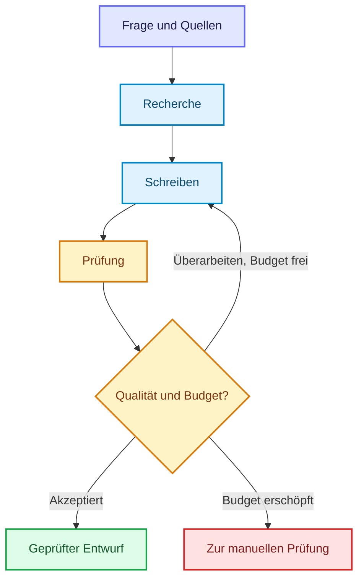

# Multi-Agent-Systeme umsetzen
{: .no_toc }

> **Ein Agententeam braucht klare Aufträge, begrenzte Kontexte und eine verantwortliche Stelle für das Ergebnis.**

Die [Architekturübersicht]({{ '/04-agenten-implementierung/entwurf/agent-architekturen.html' | relative_url }}) erklärt die Auswahl zwischen Workflows, einzelnen Agenten und Agententeams. Dieses Kapitel setzt eine begründete Rollenaufteilung voraus und zeigt ihre Umsetzung am Meeting- und Research-Briefing-Agenten.

Interaktive Demo: [Agent Patterns Lab (Multi-Agent-Muster)]({{ '/visualisierungen/agent_patterns_lab/#orchestrator' | relative_url }}){:target="_blank" rel="noopener"} – Orchestrator-Workers, Hierarchie, Swarm/Handoff, Parallel Sectioning und Parallel Voting im Browser ausprobieren.

---

# Inhaltsverzeichnis
{: .no_toc .text-delta }

1. TOC
{:toc}

---

## Wann rechtfertigt der Nutzen mehrere Agenten?

Prüfe vor der Umsetzung, welches konkrete Problem die Aufteilung löst:

| Problem | Nutzen getrennter Rollen | Einfachere Alternative zuerst prüfen |
|---|---|---|
| Zu viele Dokumente und Regeln im aktiven Kontext | Jede Rolle erhält nur ihren Fachkontext. | Retrieval, Kontextauswahl oder Skills |
| Unterschiedliche Tools und Berechtigungen | Recherche darf lesen, Versand braucht eine Freigabe. | Tool-Berechtigungen in einem Workflow |
| Unabhängige Teilaufgaben | Fachanalysen können parallel laufen. | Parallele Modellaufrufe ohne eigenständige Agenten |
| Gesonderte Prüfung des Entwurfs | Eine Prüf-Rolle bewertet nach eigenen Kriterien. | Deterministischer Validator oder einzelner Review-Aufruf |

Für das Briefing trennen wir Recherche, Schreiben und Prüfung. Das macht Arbeitsstände und Rückmeldungen sichtbar. Ob drei Agenten die Qualität gegenüber einem einfacheren Workflow verbessern, muss mit denselben Testaufgaben gemessen werden.

## Rollen, Aufträge und Berechtigungen festlegen

| Rolle | Auftrag | Erhält | Liefert | Darf nicht |
|---|---|---|---|---|
| Recherche | Fakten und Lücken ermitteln | Frage, erlaubte Quellen und Quellen-IDs | Belegte Notizen und offene Punkte | Fehlende Fakten erfinden |
| Schreiben | Kurzes Briefing formulieren | Frage, Recherche und Review-Feedback | Entwurf mit Quellen-IDs | Neue Quellen behaupten |
| Prüfung | Aussagen und Vollständigkeit bewerten | Frage, Originalquellen und Entwurf | Status und Korrekturhinweise | Externen Versand freigeben |
| Ablaufsteuerung | Schritte, Budget und Abschluss kontrollieren | Gemeinsamer State | Geprüfter Entwurf oder markierter Abbruch | Modellurteile als harte Berechtigung behandeln |

Ein Rollenprompt beschreibt die Aufgabe; Berechtigungen müssen technisch durchgesetzt werden. Ein Recherche-Agent erhält beispielsweise keine Versand-Tools. Die Prüf-Rolle braucht Originalquellen: Mit einer Zusammenfassung allein kann sie verlorene Details kaum erkennen.

## Delegation und Handoff unterscheiden

Bei **Supervisor / Orchestrator-Workers** bleiben Auftrag und Abschluss bei der zentralen Rolle. Worker liefern Teilergebnisse zurück. Der Supervisor kann dynamisch delegieren; bei bekannter Reihenfolge darf die Ablaufsteuerung vollständig im Code liegen.

Bei einem **Handoff** übernimmt die nächste Rolle die weitere Bearbeitung. Übergib mindestens:

- Ziel und Umfang des Auftrags;
- Ergebnisse mit Quellenverweisen und Artefakten;
- offene Fragen und bekannte Unsicherheiten;
- zuständige Rolle und erlaubte nächste Aktionen;
- verbleibende Aufruf-, Zeit- und Kostenbudgets.

Ein Handoff überträgt weder automatisch neue Berechtigungen noch sämtliche bisherigen Nachrichten. Übergib prüfbare Ergebnisse und benötigte Originalstellen. Interne Gedankengänge des Modells sind kein Übergabeformat.

## Gemeinsamen State und Fachkontexte trennen

Der **Shared State** hält den Arbeitsstand der Anwendung. Die einzelnen Agenten bekommen daraus jeweils nur die benötigten Felder. Ein gemeinsamer State bedeutet nicht, dass jede Rolle den gesamten Verlauf sehen muss.

Im folgenden Beispiel enthält der State Frage, Quellen, Recherche, Entwurf, Feedback, Qualität und Anzahl der Schreibversuche. Jeder Knoten gibt ausschließlich Änderungen zurück; er verändert den eingehenden State nicht direkt.

**Blackboard** nennt man eine Organisation, bei der mehrere Rollen einen gemeinsamen Arbeitsbereich beobachten und daraus ihre nächsten Aufgaben ableiten. Ein Shared State in einem fest gesteuerten Workflow ist noch kein Blackboard. Diese Variante braucht zusätzlich Aufgabenstatus, Schreibzuständigkeiten, Versionen und Konfliktregeln.

Details zu State-Schemata und Reducern stehen in [State Management]({{ '/04-agenten-implementierung/ablauf-zustand/state-management.html' | relative_url }}).

## Durchgängiges LangGraph-Beispiel

Das Beispiel verbindet drei spezialisierte LangChain-Agenten durch einen festen LangGraph-Workflow. **Die Reihenfolge ist im Code festgelegt; ein dynamisch planender Supervisor wird hier nicht benötigt.** Die Rollen erhalten keine externen Tools und arbeiten ausschließlich mit zwei bereitgestellten Beispieldokumenten. So bleibt die Koordination ohne zusätzliche Retrieval-Infrastruktur nachvollziehbar.



### State und Abbruchlogik im Überblick

Der vollständige, ausführbare Code steht im Notebook **Multi-Agent Patterns**, Abschnitt **4.1 | Briefing-Team mit begrenztem Review**: [auf GitHub ansehen](https://github.com/ralf-42/Agenten/blob/main/01_notebook/M16_Multi_Agent_Patterns.ipynb) oder [in Colab öffnen](https://colab.research.google.com/github/ralf-42/Agenten/blob/main/01_notebook/M16_Multi_Agent_Patterns.ipynb).

Das optionale Transferbeispiel folgt auf die Pipeline. Es benötigt nur die Umgebungszelle des Notebooks und die mitgelieferten Quellen; Drive-Mount und RAG-Index können für diesen Abschnitt übersprungen werden. Die späteren Notebooks vertiefen Supervisor-Steuerung sowie Reflection mit RAG, Parallelisierung und Hierarchie. Ein zusätzliches Kursmodul ist dafür nicht nötig.

Die folgenden Ausschnitte zeigen die zwei zentralen Bausteine; Imports, Rollen, Knoten, Graphaufbau, Ausführung und Kontrollprüfungen stehen im Notebook.

```python
class BriefingState(TypedDict):
    query: str
    sources: dict[str, str]
    research: str
    draft: str
    feedback: str
    quality: Literal["revise", "accepted"]
    attempts: int
    blocked: bool
```

Der State enthält Arbeitsstände und Prüfergebnis. `attempts` zählt Entwürfe; die Recherche wird beim Überarbeiten nicht wiederholt.

```python
def briefing_router(state: BriefingState) -> Literal["briefing_writer_node", "briefing_finish_node"]:
    if state["quality"] == "accepted" or state["attempts"] >= 2:
        return "briefing_finish_node"
    return "briefing_writer_node"
```

Das Routing beendet den Lauf nach einer Akzeptanz oder nach zwei Entwürfen. Der Abschlussknoten setzt `blocked=True`, wenn das Review weiterhin eine Überarbeitung verlangt.

### Was das Beispiel absichert und was offenbleibt

Die Recherche läuft einmal. Danach entstehen höchstens zwei Entwürfe mit jeweils einer Prüfung. Die Quellen-ID-Prüfung läuft vor dem bewertenden Modell; ohne gültige Referenzen wird eine Überarbeitung verlangt. Akzeptierte Ergebnisse enden als geprüfter Entwurf, nach ausgeschöpftem Budget bleibt das Ergebnis gesperrt. Das zusätzliche Rekursionslimit schützt vor unerwartet langen Graph-Läufen; es ersetzt kein Token-, Kosten- oder Zeitbudget.

**Wichtig:** Eine vorhandene Quellen-ID beweist nicht, dass die zugehörige Aussage stimmt. Der Modell-Reviewer kann ebenfalls irren. Das Beispiel enthält keine Versandfunktion und keine menschliche Freigabe. Auch ein akzeptierter Entwurf ist keine Versandgenehmigung.

Die feste Koordination lässt sich zunächst auch mit einfachen Modellaufrufen umsetzen. `create_agent()` macht hier die getrennten Rollen sichtbar; ohne Tools demonstrieren die Rollen keine autonome Recherche. Ergänze Recherche-Tools oder dynamische Delegation erst, wenn die Aufgabe sie erfordert.

Technische Fehler eines Modellaufrufs werden im Minimalbeispiel weitergegeben und beenden den Lauf. Für den Betrieb fehlen gezielte Wiederholungen, Timeouts und ein gespeicherter Fehlerstatus. Ein Test sollte erfolgreiche Erstprüfung, erfolgreiche Überarbeitung, zweimalige Ablehnung und ungültige Quellen-IDs abdecken.

## Parallel arbeiten und Ergebnisse zusammenführen

Die Schreib-Rolle benötigt die Recherche; die Prüfung benötigt den Entwurf. Diese Schritte laufen nacheinander. Für Parallelität eignen sich unabhängige Recherchen zu Terminen und Risiken.

Lege bei parallelen Workern fest:

- **Getrennte Ausgaben:** Jeder Worker liefert Ergebnis, Quellen und Bearbeitungsstatus unter einer eindeutigen Aufgaben-ID.
- **Zusammenführung:** Ein Aggregator wartet auf erforderliche Beiträge, prüft Widersprüche und benennt fehlende Teile.
- **Schreibregeln:** Mehrere Worker dürfen nicht unkontrolliert dasselbe State-Feld überschreiben. Nutze getrennte Felder oder passende Reducer.
- **Abschluss:** Bestimme, ob alle Teilergebnisse erforderlich sind oder ein gekennzeichnetes Teilergebnis genügt.

Weitere Details bietet die [LangGraph Graph API](https://docs.langchain.com/oss/python/langgraph/graph-api).

## Fehler, Widersprüche und Budgets behandeln

| Situation | Vorab festgelegte Reaktion |
|---|---|
| Worker scheitert technisch | Begrenzte Wiederholung bei vorübergehenden Fehlern; danach Fehlerstatus und Eskalation |
| Pflichtquelle fehlt | Keine Vollständigkeit behaupten; Recherche nachholen oder abbrechen |
| Aussagen widersprechen sich | Beide Belege erhalten, Widerspruch prüfen und bei Bedarf menschlich klären |
| Review bleibt negativ | Nach festem Versuchslimit mit Feedback zur manuellen Prüfung geben |
| Handoffs laufen im Kreis | Übergabezähler, offene Aufgaben und Gesamtbudget prüfen; zentral abbrechen |
| Zeit-, Token- oder Kostenbudget ist erschöpft | Arbeit stoppen und erreichten Stand nachvollziehbar ausgeben |

Entscheide ausdrücklich zwischen **Fail Fast** und **Partial Results**. Bei Fail Fast beendet ein fehlender Pflichtbeitrag den Lauf. Bei Partial Results liefert das System vorhandene Beiträge mit sichtbaren Lücken. Für ein entscheidungsrelevantes Briefing darf eine fehlende Pflichtprüfung nicht stillschweigend als Erfolg gelten.

Bei größeren Teams helfen Hierarchien erst, wenn Unterteams eigene Aufgaben und Abschlusskriterien besitzen. Bei dezentralen Teams muss trotzdem feststehen, wer Vollständigkeit prüft und den Gesamtlauf beendet. Eine weitere Rolle allein löst kein Verantwortungsproblem.

## Umsetzung prüfen

Vor der Erweiterung des Teams sollten diese Fragen beantwortet sein:

- Hat jede Rolle einen begrenzten Auftrag und passende Berechtigungen?
- Enthält jede Übergabe Ziel, Quellen, offene Punkte und einen Status?
- Sehen Prüfende die erforderlichen Originalbelege?
- Sind Wiederholungen, Handoffs und der gesamte Lauf begrenzt?
- Ist ein gesperrtes oder unvollständiges Ergebnis erkennbar?
- Werden fachliche Akzeptanz und Freigabe einer externen Aktion getrennt geprüft?
- Rechtfertigt der Gewinn an Qualität oder Laufzeit die zusätzlichen Aufrufe?

Für die Auswertung nutze [Evaluation & Observability]({{ '/07-qualitaet-sicherheit/evaluation-observability.html' | relative_url }}). Trace Aufgaben, Tool-Aufrufe, Übergaben und Prüfergebnisse; speichere keine Secrets oder unnötigen vertraulichen Dokumentinhalte.

## Quellen und nächste Schritte

- [LangChain: Multi-agent](https://docs.langchain.com/oss/python/langchain/multi-agent) – Kontextgrenzen, Subagenten und Handoffs.
- [LangGraph: Graph API](https://docs.langchain.com/oss/python/langgraph/graph-api) – State, Knoten, bedingte Übergänge und Parallelität.
- [Agenten-Architekturen]({{ '/04-agenten-implementierung/entwurf/agent-architekturen.html' | relative_url }}) – gemeinsame Auswahlhilfe.
- [Human-in-the-Loop]({{ '/04-agenten-implementierung/ablauf-zustand/human-in-the-loop.html' | relative_url }}) – Freigaben und Eskalation ergänzen.
- [Kommunikationsprotokolle]({{ '/06-multi-agent-erweiterungen/agenten-kommunikationsprotokolle.html' | relative_url }}) – Zusammenarbeit über Systemgrenzen hinweg.

---

**Version:** 2.1<br>
**Stand:** November 2026<br>
**Kurs:** KI-Agenten. Planen. Handeln. Prüfen.


