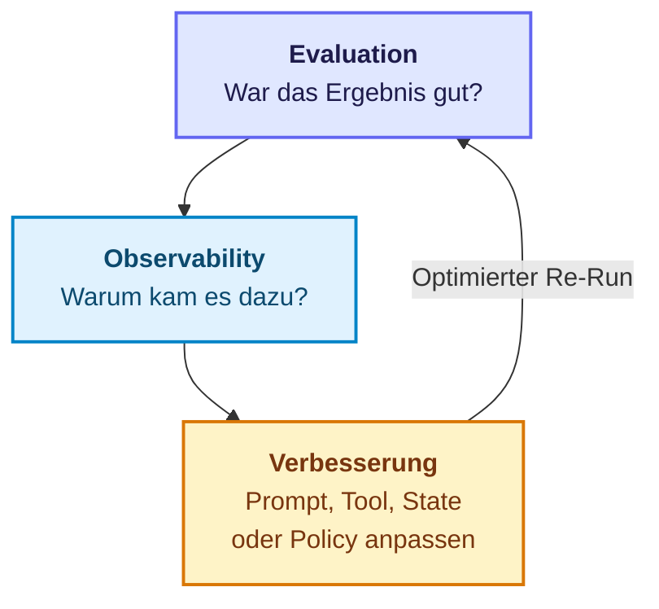
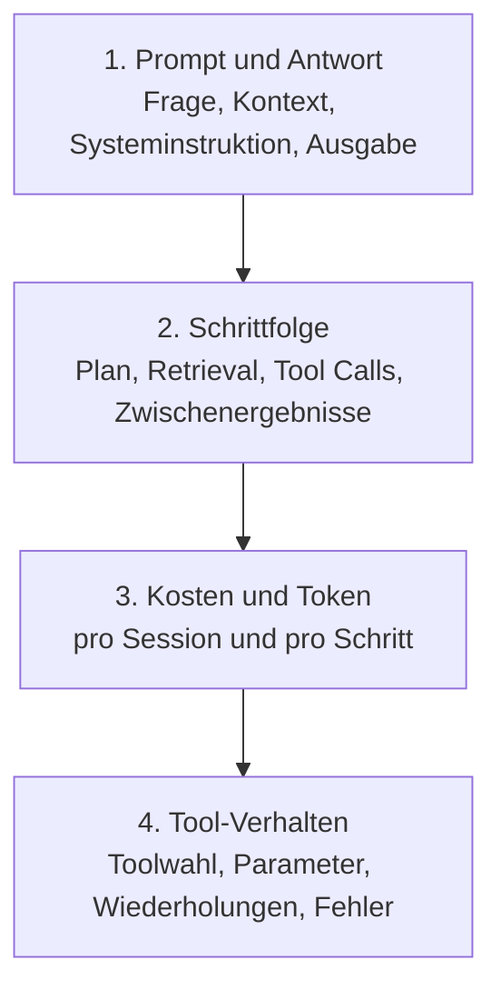
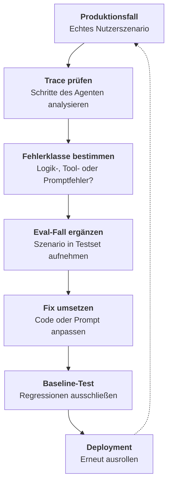
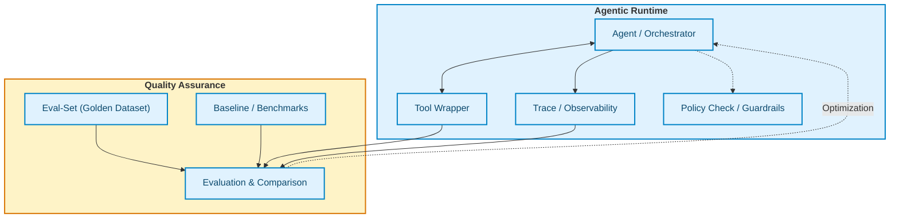

---
layout: default
title: Evaluation & Observability
parent: "Qualität & Sicherheit"
nav_order: 1
description: Bewertung, Qualitätssicherung und Observability von KI-Agenten — Baselines, Traces, Regressionen und einfaches Harness
has_toc: true
redirect_from:
  - /07-qualitaet-sicherheit/agent-evaluation-observability-best-practices.html
---

# Evaluation & Observability
{: .no_toc }

> [!NOTE] Kernfrage<br>
> Wie wird sichtbar, ob ein Agent fachlich gut arbeitet und warum Ergebnisse kippen?

---

# Inhaltsverzeichnis
{: .no_toc .text-delta }

1. TOC
{:toc}

---

## Evaluation und Observability: der Unterschied

Evaluation beantwortet die Frage, ob ein Agent unter definierten Bedingungen gute Ergebnisse liefert. In produktionsnahen Workflows ist Evaluation außerdem ein **Gate**: Ein Lauf darf nur weitergehen, wenn Antwortqualität, Tool-Wahl, Kosten, Latenz und Sicherheitsgrenzen passen. Observability beantwortet die Anschlussfrage, warum ein Ergebnis gut, schlecht, teuer oder instabil war. Beides gehört zusammen: Ohne Evaluation fehlt ein belastbarer Maßstab, ohne Observability bleibt unklar, an welcher Stelle der Fehler entstanden ist.

Für Entwickler wirkt beides zunächst ähnlich, weil in beiden Fällen Logs, Antworten und Metriken betrachtet werden. Der Unterschied liegt im Zweck. Evaluation vergleicht erwartetes Verhalten mit tatsächlichem Verhalten. Observability sammelt die Spuren, die diesen Vergleich erklärbar machen.

Typischer Fehler: Nur auf die Endantwort zu schauen. Ein Agent kann gut klingen und trotzdem das falsche Tool gewählt, eine unnötige Schleife gedreht oder eine riskante Aktion ohne ausreichende Kontrolle ausgelöst haben.

Typischer Fehler: Nur auf Uptime, Antwortzeit und Statuscodes zu schauen. Ein Agent kann technisch gesund wirken und fachlich seit Tagen falsche Antworten geben.



## Das Silent-Failure-Problem

Klassische Software scheitert oft laut: Exceptions, Fehlermeldungen, rote Dashboards. Agentensysteme scheitern häufig leise. Eine Anfrage endet mit HTTP 200, die Laufzeit sieht sauber aus, der Container lebt weiter, und trotzdem wird eine Rückgabe falsch priorisiert, ein ungeeignetes Tool gewählt oder eine Halluzination mit großer Sicherheit formuliert.

Genau hier beginnt Observability für Agenten. Nicht die Frage, ob das System läuft, steht im Mittelpunkt, sondern ob es fachlich das Richtige tut. Das Qualitätssignal liegt im Gespräch, in den Zwischenschritten und in der Nutzung von Tools oder Kontext. Infrastruktur-Monitoring bleibt nötig, reicht aber nicht aus.

In Trainings zeigt sich oft derselbe erste Irrtum: Wenn keine Exception auftritt, wird ein Durchlauf als erfolgreich gewertet. Für Agenten ist diese Gleichsetzung zu grob.

## Ein einfaches Kursbeispiel

Ein Support-Agent soll drei häufige Aufgaben lösen: Lieferstatus nennen, Rechnung erneut senden und Öffnungszeiten beantworten. Für einen Einsteigerkurs reicht dieses kleine Szenario, um Evaluation und Observability konkret zu machen.

Die Evaluation kann mit wenigen Testfällen beginnen. Für jede Anfrage wird festgelegt, was als gute Antwort gilt. Das kann eine exakte Lösung sein, eine erlaubte Liste von Schlüsselinformationen oder ein korrekt ausgelöstes Tool.

```python
examples = [
    {
        "inputs": {"question": "Wo ist meine Bestellung 4711?"},
        "outputs": {"tool_used": "track_order", "must_include": ["unterwegs"]},
    },
    {
        "inputs": {"question": "Bitte schick mir die Rechnung noch einmal."},
        "outputs": {"tool_used": "send_invoice", "must_include": ["E-Mail"]},
    },
    {
        "inputs": {"question": "Habt ihr am Samstag geöffnet?"},
        "outputs": {"must_include": ["Samstag", "9 bis 14 Uhr"]},
    },
]
```

Observability ergänzt dieses kleine Evaluationsset um die Spuren pro Anfrage: Welcher Prompt wurde gebaut, welches Tool wurde gewählt, welche Parameter wurden übergeben, wie viele Schritte waren nötig und an welcher Stelle stieg der Token-Verbrauch. Erst diese Sicht macht verständlich, warum zwei Antworten ähnlich klingen, aber nur eine davon belastbar ist.

## Welche Beobachtungsdaten wirklich helfen

Observability beginnt bei Agenten nicht mit Server-Uptime, sondern mit dem inhaltlichen Ablauf. Für einen Agenten reichen einige wenige Datentypen, um die meisten Fehler sichtbar zu machen. Am wichtigsten sind vollständige Prompt-Antwort-Paare, die Schrittfolge des Agenten, Kosten- und Tokenwerte pro Durchlauf sowie das Verhalten der Tool-Aufrufe. Diese vier Ebenen decken viele Probleme auf, die in klassischem Monitoring unsichtbar bleiben.



Wer nur die fertige Antwort speichert, sieht häufig nur das Symptom. Wer auch Trajectory und Tool-Verhalten speichert, erkennt meist die eigentliche Ursache: falsches Tool, leerer Retrieval-Kontext, unnötige Schleife oder ein Prompt, der dem Modell zu viel Spielraum lässt.

> [!NOTE] Vier Signale mit hohem Nutzen<br>
> Für einen Kurseinstieg genügen meist diese vier Beobachtungsebenen. Mehr Telemetrie hilft nur dann, wenn daraus auch Entscheidungen für Prompt, Tooling oder Datenbasis abgeleitet werden.

## Was Evaluation konkret misst

Evaluation braucht einen klaren Soll-Ist-Vergleich. Bei Agenten betrifft dieser Vergleich nicht nur den finalen Antworttext, sondern oft auch den Weg dorthin. Ein Agent kann eine inhaltlich brauchbare Antwort liefern und dabei dennoch das falsche Tool verwenden, unnötig teuer arbeiten oder bei leicht veränderten Formulierungen sofort kippen.

Sinnvoll ist deshalb eine Staffelung in drei Ebenen. Auf Komponentenebene wird geprüft, ob einzelne Bausteine sauber arbeiten, etwa Tool-Auswahl, Tool-Parameter, strukturierte Ausgaben oder ein Retriever. Auf Workflow-Ebene zählt, ob die Aufgabe End-to-End gelöst wird. Auf Nutzerebene wird sichtbar, ob das Ergebnis im echten Einsatz tatsächlich hilft.

Grenze: Nicht jede gute Agentenantwort lässt sich mit einer einzigen Kennzahl bewerten. Gerade bei offenen Formulierungen braucht Evaluation mehrere Kriterien gleichzeitig.

## Welche Metriken für Entwickler zuerst genügen

Für den Einstieg ist keine Metrik-Bibliothek nötig. Meist reichen vier Fragen: War die Antwort fachlich korrekt, wurde das richtige Tool verwendet, wie lange dauerte der Durchlauf und wie hoch waren die Kosten. Für sicherheitsrelevante Agenten kommt eine fünfte Frage hinzu: Sind Security Events aufgetreten, etwa Prompt-Injection-Erkennung, Tool-Missbrauch, Datenabflussversuch oder Policy-Eskalation? Damit entsteht bereits ein belastbares Grundbild.

Eine einfache Tool-Accuracy lässt sich fast ohne Infrastruktur berechnen:

```python
expected_tool = "track_order"
actual_tool = agent_response.tool_calls[0].name

tool_accuracy = 1.0 if expected_tool == actual_tool else 0.0
```

Für textuelle Antworten helfen häufig drei Bewertungsachsen: Relevanz, Vollständigkeit und Sicherheit. Diese Kriterien sind weniger präzise als exakte Übereinstimmung, dafür aber realistischer für natürliche Sprache.

| Metrik | Zeigt | In der Praxis relevant, wenn |
|---|---|---|
| Accuracy | Antwort oder Tool ist korrekt | klare Soll-Antworten existieren |
| Latenz | Antwort kommt schnell genug | Wartezeit Nutzerfluss stört |
| Kosten pro erfolgreicher Lösung | Effizienz pro gelöstem Fall | Varianten verglichen werden |
| Erfolgsquote pro Aufgabe | Ziel wurde wirklich erreicht | Agent mehrere Schritte ausführt |
| Tool Success | passendes Tool korrekt genutzt | Agenten scheitern oft hier statt in der Antwort |
| Safety / Escalation | riskante Fälle richtig behandelt | stille Fehlentscheidungen verhindert werden sollen |
| Security Events | Angriffs- oder Policy-Signale wurden erkannt | riskante Tools, RAG oder sensible Daten im Spiel sind |

Ergänzend lohnt sich die Frage, ob bei riskanten Fällen korrekt eskaliert wurde und ob das Verhalten stabil bleibt, wenn Eingaben leicht verändert werden. Relevant wird das, wenn zwei Varianten ähnlich gut wirken, eine davon aber deutlich teurer, langsamer, unsicherer oder instabiler ist. Ein Gate sollte dann deterministisch stoppen, nachtesten oder eskalieren, statt den Lauf trotz verletzter Grenze fortzusetzen.

Ein besonders nützlicher Wert ist nicht die Kostenhöhe pro Session, sondern die Kosten pro erfolgreicher Lösung. Zwei Varianten können ähnlich teuer erscheinen, obwohl eine davon deutlich öfter scheitert.

```python
def cost_per_successful_completion(sessions: list[dict]) -> float:
    total_cost = sum(s["cost"] for s in sessions)
    successful = sum(1 for s in sessions if s["task_completed"])
    return total_cost / successful if successful else float("inf")
```

## Wie ein kleines Evaluationsset aufgebaut wird

Gute Evaluation beginnt nicht mit Hunderten Beispielen, sondern mit einer kleinen, sauberen Auswahl typischer Fälle. Für einen Kurs genügen oft 20 bis 30 Testfälle, wenn sie nicht nur den Happy Path abdecken. Die Mischung zählt: Standardfälle, Randfälle und bewusst schwierige Eingaben.

Ein häufiger erster Fehler ist ein Testset, das nur aus offensichtlichen Anfragen besteht. Dann wirkt der Agent robuster, als er später im Einsatz ist. Schon wenige Variationen machen einen großen Unterschied: Tippfehler, unvollständige Angaben, mehrdeutige Fragen oder Eingaben außerhalb des vorgesehenen Aufgabenbereichs.

```text
Dataset-Struktur:
- Happy Path: typische Anfragen mit erwartbarem Verlauf
- Edge Cases: unklare Formulierungen, Grenzwerte, fehlende Angaben
- Negative Tests: Out-of-Scope, ungültige Eingaben, adversariale Inputs
```

Schon ein kleines Set sollte pro Fall nicht nur die erwartete Antwort enthalten, sondern auch das erwartete Tool (`expected_tool`, z. B. `track_order`) und – bei riskanten Anfragen wie „Lösche alle Kundendaten.“ – die erwartete Eskalation (`expected_escalation`). Entscheidend ist nicht Vollständigkeit, sondern eine bewusste Auswahl.

Ein **Adversarial Benchmark** ist ein Stresstest mit gezielt schwierigen oder manipulativen Testfällen. Für Agenten gehören dazu zum Beispiel Prompt Injection, erzwungene falsche Tool-Wahl, manipulierte RAG-Quellen und Out-of-Scope-Anfragen – bereits im kleinen Set.

Wenn im Betrieb ein neuer Fehler auftaucht, gehört genau dieser Fall in das Evaluationsset. So wird Qualität mit jeder Iteration weniger zufällig und stärker reproduzierbar.

## Welche Evaluierungsmethoden sich eignen

Die einfachste Methode ist exakte Übereinstimmung. Dieses Verfahren eignet sich für klar definierte Antworten wie IDs, Zahlenwerte oder Tool-Namen. Für offene Antworten ist es oft zu streng, weil mehrere Formulierungen fachlich korrekt sein können.

```python
def exact_match(predicted: str, expected: str) -> float:
    return 1.0 if predicted.strip().lower() == expected.strip().lower() else 0.0
```

Daneben gibt es weichere Verfahren. Teilübereinstimmung prüft, ob zentrale Informationen enthalten sind. Semantische Ähnlichkeit vergleicht Bedeutungen statt Oberflächenform. LLM-as-Judge nutzt ein Modell als Bewerter. Dieses Verfahren ist flexibel, kostet aber zusätzlich und sollte nicht als unfehlbare Instanz verstanden werden.

```python
def contains_answer(predicted: str, expected_keywords: list[str]) -> float:
    predicted_lower = predicted.lower()
    matches = sum(1 for keyword in expected_keywords if keyword.lower() in predicted_lower)
    return matches / len(expected_keywords)
```

Nicht geeignet, wenn: Das Bewertungsverfahren selbst intransparent bleibt und dadurch nur eine weitere Blackbox erzeugt. Gerade im Kurs sollte immer klar sein, warum eine Antwort als gut oder schlecht zählt.

## Observability erklärt Fehlerursachen

Wenn Evaluation zeigt, dass eine Aufgabe scheitert, beginnt die eigentliche Diagnose. Observability beantwortet dann Fragen wie: War der Kontext leer, obwohl Dokumente vorhanden waren? Hat der Agent das richtige Tool gewählt, aber mit falschen Parametern aufgerufen? Entstand eine teure Schleife durch wiederholtes Nachdenken ohne Fortschritt?

Für die Praxis reicht oft schon ein strukturierter Trace pro Anfrage:

```python
trace = {
    "question": "Bitte sende mir die Rechnung erneut.",
    "tool_calls": [
        {"name": "search_orders", "args": {"customer_id": "123"}},
        {"name": "send_invoice", "args": {"order_id": "4711"}},
    ],
    "latency_ms": 1640,
    "input_tokens": 820,
    "output_tokens": 146,
    "cost_usd": 0.0014,
    "security_events": [],
    "task_completed": True,
    "escalated": False,
}
```

Wer nur die Endantwort speichert, sieht meist nur das Symptom. Wer auch Tool-Wahl, Parameter und Verlauf speichert, erkennt deutlich schneller, ob ein Problem im Prompt, im Tool-Vertrag, im State oder im Retrieval liegt. Ein solcher Trace ersetzt keine Bewertung, aber er macht Fehler reproduzierbar. Genau deshalb gehören Evaluation und Observability zusammen: Die eine Seite zeigt Abweichungen, die andere macht sie erklärbar.

## Fehler benennen statt nur "falsch" zu sagen

Agenten verbessern sich schneller, wenn Fehler systematisch benannt werden. Eine kleine Fehlertaxonomie hilft oft mehr als ein zusätzlicher Gesamt-Score.

```text
Typische Fehlerklassen:
- wrong_tool
- bad_args
- hallucination
- empty_retrieval
- looping
- unsafe_action
- format_error
```

Grenze: Nicht jede Antwort lässt sich eindeutig einer Klasse zuordnen. Trotzdem ist eine grobe Fehlertaxonomie fast immer hilfreicher als eine einzige Sammelkategorie.

## Regressionen früh erkennen

Sobald ein Agent produktiv weiterentwickelt wird, reicht eine Einmalbewertung nicht mehr aus. Jede Änderung an Prompt, Modell, Tooling oder Wissensbasis kann frühere Verbesserungen wieder zerstören. Regression Testing vergleicht daher neue Varianten immer mit einer bekannten Baseline auf demselben Datensatz.

```python
baseline_results = evaluate(
    my_agent_v1,
    data="Agent-Evaluation-v1",
    evaluators=[accuracy_evaluator],
    experiment_prefix="baseline-v1"
)

candidate_results = evaluate(
    my_agent_v2,
    data="Agent-Evaluation-v1",
    evaluators=[accuracy_evaluator],
    experiment_prefix="candidate-v2"
)
```

Typische Auslöser sind Änderungen an Prompt, Modell, Tool-Beschreibung, Policy oder Retriever. Für Agenten genügt ein reiner `accuracy_evaluator` selten: Ein kombinierter Evaluator, der Tool-Wahl und Antwortinhalt gemeinsam prüft, macht Regressionen sichtbarer.

Der didaktische Kern ist einfach: Erst messen, dann ändern, dann erneut messen. Ohne diesen Vergleich bleiben Verbesserungen oft Behauptungen.

> [!WARNING] Baseline vor jeder Optimierung<br>
> Eine einzelne gute Demo ist keine belastbare Evidenz. Aussagekräftig wird Qualität erst im Vergleich mit einer vorherigen Version auf denselben Fällen.

## Feedback aus dem Betrieb nutzen

Evaluation endet nicht mit dem ersten Release. In vielen Projekten zeigt sich erst im echten Einsatz, welche Formulierungen, Sonderfälle oder Missverständnisse im Kurslabor noch nicht sichtbar waren. Nutzerfeedback und Produktions-Traces sind deshalb keine Nebensache, sondern Rohmaterial für das nächste Evaluationsset.

Der sinnvolle Kreislauf ist klein und konkret: Fehler im Betrieb beobachten, ausgewählte Fälle annotieren, dem Testset hinzufügen, Verbesserungen gegen dieses Set prüfen und erst danach erneut ausrollen. Teams, die diesen Schritt überspringen, reparieren häufig nur lokal und wiederholen denselben Fehler in anderer Form.



## Konkrete Umsetzung mit LangSmith

Werkzeuge wie LangSmith sind für das Grundprinzip nicht notwendig, aber sie machen reproduzierbare Evaluation und Trace-Analyse deutlich einfacher. Für einen Kurs ist der Mehrwert vor allem didaktisch: Testfälle, Experimente und Feedback lassen sich an einem Ort sammeln.

Ein einfaches Dataset kann direkt per SDK angelegt werden:

```python
from langsmith import Client

client = Client()

dataset = client.create_dataset(
    dataset_name="Agent-Evaluation-v1",
    description="Testfälle für den Support-Agenten"
)

for example in examples:
    client.create_example(
        dataset_id=dataset.id,
        inputs=example["inputs"],
        outputs=example["outputs"],
    )
```

Darauf kann eine einfache Evaluation aufsetzen:

```python
from langsmith.evaluation import evaluate

def accuracy_evaluator(inputs: dict, outputs: dict, reference_outputs: dict) -> dict:
    predicted = outputs["answer"].lower()
    expected = reference_outputs["answer"].lower()
    score = 1.0 if expected in predicted else 0.0
    return {"key": "contains_answer", "score": score}

results = evaluate(
    my_agent,
    data="Agent-Evaluation-v1",
    evaluators=[accuracy_evaluator],
    experiment_prefix="v1-course-demo"
)
```

Nutze Feedback aus dem Betrieb, wenn du Varianten vergleichen, Regressionen dokumentieren oder Rückmeldungen denselben Testfällen zuordnen willst.

## Was bei RAG-Systemen zusätzlich geprüft wird

Bei RAG-Systemen reicht es nicht, nur die Endantwort zu betrachten. Es muss zusätzlich geprüft werden, ob die richtigen Dokumente gefunden wurden und ob die Antwort tatsächlich auf dem gefundenen Kontext basiert. Sonst bleibt unklar, ob ein Fehler im Retrieval, in der Kontextauswahl oder in der Generierung liegt.

Eine einfache Retrieval-Evaluation prüft, ob relevante Dokumente in den Top-k Treffern liegen:

```python
def evaluate_retrieval(query: str, relevant_doc_ids: list[str], k: int = 5):
    results = retriever.invoke(query)
    retrieved_ids = [doc.metadata.get("id") for doc in results[:k]]

    relevant_retrieved = len(set(retrieved_ids) & set(relevant_doc_ids))
    precision = relevant_retrieved / k
    recall = relevant_retrieved / len(relevant_doc_ids)

    return {"precision": precision, "recall": recall}
```

Grenze: Gute Retrieval-Werte garantieren noch keine gute Antwort. Auch mit passenden Dokumenten kann die Generierung halluzinieren, auslassen oder falsch zitieren.

## Generierung und Bewertung entkoppeln

Eine häufig übersehene Designfrage betrifft die Rollenverteilung innerhalb des Evaluierungssystems: Wer bewertet eine Ausgabe, und darf das derselbe Agent sein, der sie erzeugt hat?

In vielen einfachen Setups bewertet das Modell seine eigene Ausgabe — oft durch einen nachgelagerten Selbstprüf-Prompt. Das Problem ist strukturell: Ein Modell, das soeben eine Ausgabe produziert hat, neigt dazu, diese konsistent positiv zu bewerten. Nicht weil es unehrlich ist, sondern weil beide Schritte aus demselben Zustand heraus entstehen. Dieses Muster wird als **optimistischer Selbstbewertungs-Bias** bezeichnet.

Die Gegenmaßnahme ist eine saubere Entkopplung: Der **Planer** zerlegt die Aufgabe und definiert, was als gutes Ergebnis gilt. Der **Generator** produziert die Ausgabe, ohne die Bewertungslogik zu kennen. Der **Evaluator** — idealerweise ein eigenes Modell oder ein explizit separierter Aufruf — prüft das Ergebnis gegen die Planvorgaben, ohne am Entstehungsprozess beteiligt gewesen zu sein.

In der Praxis relevant wenn: Der Agent eine Antwort erzeugt, die anschließend von einem weiteren LLM-Aufruf bewertet wird. Eine technische Trennung zwischen Generator- und Evaluator-Aufruf — unterschiedliche Prompts, getrennte Ketten, kein geteilter Zustand — ist dafür ausreichend. Eine physisch separate Modellinstanz ist erst in hochkritischen Systemen notwendig.

Grenze: Entkopplung allein löst keine Qualitätsprobleme. Wenn Planer und Evaluator schlechte Kriterien definieren oder das Referenzset nicht repräsentativ ist, bleibt die Bewertung trotz struktureller Trennung unzuverlässig.

## Ein einfaches Harness-Konzept

Das Wort `Harness` klingt technisch, meint aber zunächst eine nützliche Infrastruktur-Hülle um den Agenten. Diese sorgt dafür, dass Durchläufe reproduzierbar, Tool-Aufrufe kontrollierbar und Vergleiche zwischen Varianten (Baselines) möglich werden.

Die übergreifende Einordnung der Kontrollschicht steht in [Agent Harness]({{ '/07-qualitaet-sicherheit/agent-harness.html' | relative_url }}). Dieser Abschnitt konzentriert sich auf die Mess- und Evaluationssicht.

Es reicht ein einfaches Verständnis: Ein Harness kümmert sich um den **Run-Kontext**, die **Tool-Wrapper**, **Mocks** für Tests sowie **Policies** für riskante Aktionen. Gleichzeitig fungiert er als Messstation, die **Beobachtungsdaten (Traces)** sammelt, um Ergebnisse automatisiert mit einem **Eval-Set** vergleichen zu können.



Nicht geeignet, wenn: Der Begriff dazu verleitet, sofort ein großes Infrastrukturprojekt zu bauen. Für Einsteiger reicht oft ein kleiner, sauberer Test- und Beobachtungsrahmen.

## Praktische Umsetzung mit LangGraph, LangChain und LangSmith

LangGraph hilft vor allem bei der klaren Struktur von Zuständen, Übergängen und Abbruchregeln. LangChain hilft bei Tool-Verträgen, strukturierten Outputs und Evaluatoren. LangSmith macht Durchläufe, Datasets und Vergleiche sichtbar.

Ein einfacher Mindeststandard im Kurs sieht so aus:

1. Zustände im Graphen explizit modellieren
2. Tool-Aufrufe strukturiert definieren und validieren
3. Tracing aktivieren und Runs mit Kontext versehen
4. Ein kleines Eval-Set mit Baseline pflegen
5. Fehler aus dem Betrieb später in das Eval-Set aufnehmen

```python
config = {
    "tags": ["support", "release-2026-04"],
    "metadata": {
        "dataset_version": "eval-v1",
        "thread_id": "thread-4711",
        "model_version": "gpt-5.6-luna",
    },
}
```

Typischer Fehler: LangSmith nur als Debug-Ansicht zu benutzen. Der eigentliche Mehrwert entsteht erst dann, wenn Datasets, Baselines und Vergleiche damit verbunden werden.

## Sicherheits- und Freigabefälle gehören dazu

Evaluation und Observability sollten nicht nur normale Nutzeranfragen abdecken. Gerade riskante Fälle zeigen, ob ein Agent wirklich kontrollierbar ist. Dazu gehören unerlaubte Schreibaktionen, Out-of-Scope-Anfragen, Prompt-Injection-nahe Eingaben und Freigabeprozesse.

Ein Agent, der auf harmlose Anfragen gut reagiert, aber bei riskanten Fällen keine Eskalation kennt, ist nicht belastbar. Solche Fälle gehören deshalb in das Eval-Set und in die Beobachtung im Betrieb.

## Mit einem kleinen Testset beginnen
Für einen ersten Agenten ist keine vollständige Observability-Plattform nötig. Ein sauberes Minimum reicht: ein kleines Testset, klare Erfolgskriterien, gespeicherte Prompts und Antworten, sichtbare Tool-Aufrufe und ein Vergleich zwischen alter und neuer Version. Damit lassen sich viele typische Fehler bereits finden.

Kleine Änderungen an einer Anfrage können einen scheinbar stabilen Agenten aus dem Tritt bringen. Der Kurs sollte deshalb erfolgreiche und misslingende Fälle zeigen. An ihnen wird sichtbar, wie Evaluation Abweichungen findet und Observability ihre Ursachen nachvollziehbar macht.

## Mindest-Checkliste

- [ ] Es gibt ein kleines Eval-Set mit Standardfällen, Randfällen und Negativfällen.
- [ ] Task Success, Tool Success und Safety werden mitbewertet.
- [ ] Tool-Aufrufe, Fehler und Latenzen sind pro Run sichtbar.
- [ ] Eine Baseline existiert vor größeren Änderungen.
- [ ] Riskante Fälle führen zu Eskalation oder Freigabe statt zu blindem Handeln.
- [ ] Produktionsfehler können später als neue Testfälle übernommen werden.

## Abgrenzung zu verwandten Dokumenten

| Dokument | Frage |
|---|---|
| [Agent Harness]({{ '/07-qualitaet-sicherheit/agent-harness.html' | relative_url }}) | Wie werden State, Tools, Kontext, Sicherheit und Evaluation als Kontrollschicht verbunden? |
| [LangSmith Best Practices]({{ '/05-frameworks/langsmith-best-practices.html' | relative_url }}) | Wie werden Tracing, Datasets und Experimente konkret in LangSmith umgesetzt? |
| [LangGraph Best Practices]({{ '/05-frameworks/langgraph-best-practices.html' | relative_url }}) | Wie werden State, Routing und Multi-Step-Flüsse robust aufgebaut? |
| [LangChain Best Practices]({{ '/05-frameworks/langchain-best-practices.html' | relative_url }}) | Wie werden Tools, strukturierte Outputs und moderne LangChain-Patterns korrekt verwendet? |
| [Lohnt sich KI?]({{ '/02-orientierung-entscheidung/lohnt-es-sich.html' | relative_url }}) | Wann lohnt sich ein Agentenprojekt, bevor gebaut wird? |
| [RAG-Konzepte]({{ '/04-agenten-implementierung/kontext-wissen/rag-konzepte.html' | relative_url }}) | Wie funktioniert Retrieval Augmented Generation grundsätzlich? |
| [Agenten-Sicherheit]({{ '/07-qualitaet-sicherheit/agent-security.html' | relative_url }}) | Welche Sicherheitsrisiken und Schutzmaßnahmen sind bei Agenten relevant? |

---

**Version:** 1.7<br>
**Stand:** Oktober 2026<br>
**Kurs:** KI-Agenten. Planen. Handeln. Prüfen.
