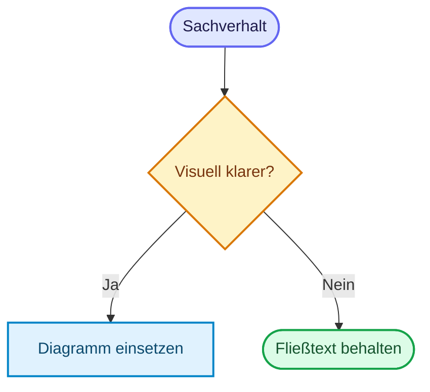

---
layout: default
title: Markdown Template Guide
nav_exclude: true
description: Vorlage und Regeln für Markdown-Dateien in docs/ nach dem verbindlichen Doku-Standard
has_toc: true
---

# Markdown Template Guide
{: .no_toc }

> **Vorlage und Regeln für Markdown-Dateien in `docs/` nach dem verbindlichen Doku-Standard**

---

# Inhaltsverzeichnis
{: .no_toc .text-delta }

1. TOC
{:toc}

---

## Ziel und Geltungsbereich

Diese Datei übersetzt den gemeinsamen Dokumentstandard (`_docs/Dokument_Standard.md` im Workspace-Stammverzeichnis) in eine Arbeitsvorlage für `Agenten/docs/`. Maßgeblich bleibt der gemeinsame Standard. Diese Anleitung ergänzt ihn um die Jekyll-, Just-the-Docs- und Mermaid-Konventionen dieses Projekts.

---

## Grundprinzip

Für alle Dokumente in `docs/` gilt: **Substanz vor Struktur**. Formatierung hilft beim Lesen, ersetzt aber keinen präzisen Text. Ein sauber formulierter Absatz ist fast immer besser als eine Kette aus Bullet Points.

Aufzählungen werden nur eingesetzt, wenn echte Parallelstruktur vorliegt. Abschnitte mit zusammenhängender Argumentation bleiben Fließtext. Aussagen wie "praxisorientiert", "ganzheitlich" oder "state of the art" werden vermieden, wenn sie nicht durch ein Beispiel oder einen überprüfbaren Beleg gedeckt sind.

In Sachtexten sind unpersönliche Formulierungen der Regelfall. Bei Anleitungen ist eine direkte Ansprache zulässig, wenn sie den nächsten Schritt klarer macht. Innerhalb eines Dokuments bleibt die gewählte Ansprache konsistent.

**Ausnahme Legal-Seiten:** In `rechtliches.md`, `impressum.md`, `datenschutz.md` und `haftungsausschluss.md` bleibt die "Sie"-Form erhalten. Gesetzliche Texte folgen der Rechtssprache; navigationsbezogene Sätze in `rechtliches.md` (z. B. "finden Sie im Footer") sind Teil dieser Konvention.

---

## Standard-Template für Inhaltsseiten

Diese Vorlage gilt für inhaltliche Dokumente in den thematischen Bereichen der GitHub-Pages-Dokumentation.

````markdown
---
layout: default
title: Titel des Dokuments
parent: Ressourcen
description: Prägnanter Beschreibungstext für Navigation und SEO
has_toc: true
---

# Titel des Dokuments
{: .no_toc }

> **Prägnanter Beschreibungstext für Navigation und SEO**

---

# Inhaltsverzeichnis
{: .no_toc .text-delta }

1. TOC
{:toc}

---

## Erstes Kapitel

Hier steht zusammenhängender Text. Bullet Points nur dann, wenn mehrere wirklich gleichwertige Punkte nebeneinanderstehen.

---

## Zweites Kapitel

Hier folgt der eigentliche Inhalt.

---

## Drittes Kapitel

Ein Inhaltsverzeichnis wird eingesetzt, wenn die Seitenlänge und Gliederung es sinnvoll machen.

---

<!-- Nur ergänzen, wenn verwandte Fachseiten sinnvoll voneinander abgegrenzt werden. -->

## Abgrenzung zu verwandten Dokumenten

| Dokument | Frage |
|---|---|
| [Verwandtes Dokument](#) | Worum geht es dort? |

---

**Version:** [Versionsnummer]<br>
**Stand:** [Monat Jahr]<br>
**Kurs:** [Kursbezeichnung]
````

Die Vorlage ist ein Ausgangspunkt, kein Zwang zur Textaufblähung. Wenn ein Sachverhalt mit zwei starken Absätzen erklärt ist, bleibt es bei zwei starken Absätzen.

---

## Pflichtregeln

### Frontmatter

Jede Inhaltsseite in `docs/` beginnt mit dem Frontmatter, das der Seitentyp und die Site-Konfiguration erfordern. Für eine verschachtelte Fachseite ist dies ein typisches Muster:

```yaml
---
layout: default
title: Titel des Dokuments
parent: Ressourcen
grand_parent: Konzepte
nav_order: 2
description: Prägnanter Beschreibungstext für Navigation und SEO
has_toc: true
---
```

`parent` und `grand_parent` müssen zur Navigation passen. `nav_order` zählt innerhalb der Elternseite und muss mit der vorgesehenen Reihenfolge übereinstimmen. `has_toc: true` wird gesetzt, wenn ein Inhaltsverzeichnis verwendet wird; bei kurzen Seiten gilt die Seitentypregel aus dem gemeinsamen Standard. `description` bleibt knapp und ist kein Teaser-Absatz.

### Titel

Einstiegs- und Orientierungsdokumente verwenden nach Möglichkeit ein W-Frage-Format, etwa `Lohnt es sich überhaupt?` oder `Welches Werkzeug?`. Technische Referenzdokumente behalten präzise technische Titel wie `Checkpointing & Persistenz` oder `Agent Security`.

### Inhaltsverzeichnis

Ein automatisches Inhaltsverzeichnis wird bei mehr als drei inhaltlichen Überschriften der Ebene `##` verwendet. Bei kürzeren Seiten entscheidet der tatsächliche Orientierungsbedarf. Frontmatter und reine Metadaten zählen nicht mit.

```markdown
# Inhaltsverzeichnis
{: .no_toc .text-delta }

1. TOC
{:toc}
```

Kurze Seiten mit bis zu drei inhaltlichen Überschriften der Ebene `##` benötigen in der Regel kein TOC.

### Abgrenzung verwandter Dokumente

Eine Abgrenzungstabelle steht vor dem Versionsblock, wenn sie die Orientierung zu verwandten Fachseiten verbessert. Für kurze Erklärungen oder Seiten ohne sinnvolle Abgrenzung wird sie weggelassen.

```markdown
## Abgrenzung zu verwandten Dokumenten

| Dokument | Frage |
|---|---|
| [Titel](#) | Worum geht es dort? |
```

### Versionsblock

Gepflegte Fachseiten verwenden den Versionsblock, sofern die Projektregeln ihn vorsehen. Kategorie-, Index-, Rechts- und Übersichtsseiten folgen den Ausnahmen des gemeinsamen Standards. Der `Stand` wird bei einer inhaltlichen Aktualisierung angepasst.

```markdown
**Version:** [Versionsnummer]<br>
**Stand:** [Monat Jahr]<br>
**Kurs:** [Kursbezeichnung]
```

---

## Schreibregeln

### Aufzählungen sparsam einsetzen

Aufzählungen passen nur bei echter Parallelstruktur. Was sich als Begründung, Abwägung oder Ablauf erzählen lässt, bleibt Fließtext.

**Nicht geeignet sind zum Beispiel:**
- Gedankengänge mit Ursache und Wirkung
- Sätze, die sich sinnvoll mit "und", "weil" oder "deshalb" verbinden lassen
- Abschnitte, die nur aus Mini-Sätzen unter mehreren Überschriften bestehen

### Mehrwert statt Selbstbeschreibung

Eigenschaften werden nicht behauptet, sondern gezeigt. Statt "praxisorientiertes Training" ist ein Satz wie "Im Modul entsteht ein lauffähiges RAG-System" belastbar.

### Grenzen benennen

Gute Doku beschreibt nicht nur, was funktioniert, sondern auch, wo ein Ansatz scheitert, wann er aufwendig wird und welche Fehlannahmen häufig auftreten.

### Satzvarianz

Satzlänge und Satzbau dürfen variieren, wenn es dem Lesefluss hilft. Leitfragen eignen sich, wenn sie eine echte Entscheidung oder Orientierung eröffnen.

### Codebeispiele

Fenced Codeblöcke erhalten einen passenden Sprach-Tag, zum Beispiel `python`, `bash`, `yaml`, `markdown` oder `mermaid`. Konsolenausgaben und Klartext werden als Text gekennzeichnet.

Codebeispiele entsprechen den technischen Regeln in `Agenten/CLAUDE.md` und den einschlägigen Best-Practice-Dokumenten. APIs und Beispiele müssen zur angegebenen Version passen. Ausführbare Beispiele werden geprüft; Ausschnitte und Pseudocode werden als solche kenntlich gemacht. Notebook-spezifische Einrichtungszellen oder Importkonventionen werden nur übernommen, wenn sie für das Beispiel erforderlich sind.

---

## Strukturregeln

### Überschriftenhierarchie und Nummerierung

In Inhaltsseiten steht eine H1 (`#`) für den Seitentitel; Kapitel beginnen mit H2 (`##`). Unterebenen werden der Reihe nach verwendet, ohne Ebenen zu überspringen. Das Inhaltsverzeichnis darf als zusätzliche H1 stehen, wenn es mit `{: .no_toc }` aus der Seitenübersicht ausgeblendet wird.

Überschriften in Fachseiten werden nicht manuell nummeriert. Nummerierte Abschnitte sind in Governance- und Regelwerken zulässig, wenn sie das Referenzieren erleichtern.

**Falsch:**

```markdown
## 1 Überblick
### 1.1 Installation
```

**Richtig:**

```markdown
## Überblick
### Installation
```

### Überschriften dienen der Gliederung

Überschriften strukturieren den Text, sie ersetzen ihn nicht. Ein Abschnitt mit nur einem Halbsatz unter einer eigenen H2 ist kein tragfähiger Abschnitt.

### Trennlinien gezielt einsetzen

`---` trennt Hauptabschnitte sichtbar voneinander. Zwischen einzelnen Unterpunkten innerhalb desselben Gedankengangs wird keine zusätzliche Trennlinie eingefügt.

---

## Link-Konventionen

In Index-Dokumenten wie `concepts.md` oder `frameworks.md` werden absolute URLs verwendet:

```markdown
[Digitale Souveränität]({{ '/09-regulatorik-verantwortung/digitale-souveraenitaet.html' | relative_url }})
```

Innerhalb inhaltlicher Dokumente werden relative `.html`-Links verwendet:

```markdown
[Agent-Architekturen]({{ '/04-agenten-implementierung/entwurf/agent-architekturen.html' | relative_url }})
[Modellauswahl]({{ '/03-modelle-provider-anpassung/modellauswahl.html' | relative_url }})
```

Regeln:

- Immer `.html`, nie `.md`
- Dateiname exakt wie auf der Festplatte
- Keine trailing slashes bei Datei-URLs
- Seiten mit eigenem `permalink:` verwenden für interne Verweise besser absolute URLs

---

## Callouts und Mermaid

### Callouts

Im Projekt wird GitHub-Alert-Syntax verwendet. Der Titel nach dem Alert-Typ ist Pflicht.

```markdown
> [!NOTE] Kontext<br>
> Ergänzende Information, die den Haupttext nicht unterbrechen soll.

> [!WARNING] Einschränkung<br>
> Bekannte Fehlerquelle oder wichtige Grenze.
```

Callouts heben einzelne Hinweise hervor, die sich sinnvoll vom Lesefluss absetzen. Eine feste Höchstzahl pro Abschnitt gibt es nicht; entscheidend ist, dass die Hervorhebungen Orientierung schaffen.

### Mermaid

Mermaid wird nur eingesetzt, wenn ein Zusammenhang visuell klarer wird als im Fließtext oder in einer Tabelle. Geeignet sind Entscheidungslogik, Zustandswechsel, Sequenzen und Architekturübersichten. `sequenceDiagram` kann mit `autonumber` nummeriert werden, wenn die Nummern den Ablauf leichter referenzierbar machen.

Das Farbschema (`theme: base` mit `themeVariables`) ist global in `_includes/head_custom.html` gesetzt, ein Init-Block pro Diagramm entfällt. Flowcharts färben Knoten ausschließlich über `classDef` und `class` (`default`, `input`, `metric`, `output`, `target`, `stop`), nie über einzelne `style`-Zeilen. `sequenceDiagram`, `stateDiagram-v2` und `mindmap` kommen ohne `classDef` aus. Ausnahme: Ein Vergleich zweier Subgraphen darf `style` mit Palette-Hexwerten nutzen. Subgraph-Titel werden mit `<b>` gesetzt, z. B. `subgraph ID["<b>Titel</b>"]`. Palette und Begründung: `_docs/Mermaid_Best_Practices.md`.

````markdown

````

---

## Kategorie-Seiten

Kategorie-Seiten wie `concepts.md` oder `frameworks.md` dienen der Orientierung. Sie verwenden `has_children: true` und bei Bedarf `permalink:`. Die Einträge arbeiten mit absoluten URLs und ergänzen technische Titel durch eine kursive W-Frage.

````markdown
---
layout: default
title: Konzepte
has_children: true
description: Theoretische Grundlagen und technische Konzepte für KI-Agenten
---

# Konzepte

Kurze Einordnung des Bereichs in einem Absatz.

## Grundlagen

- **[Checkpointing & Persistenz]({{ '/04-agenten-implementierung/ablauf-zustand/checkpointing-persistenz.html' | relative_url }})** – *Wie werden Sitzungen gespeichert?* Zustandsspeicherung und Session-Persistenz in LangGraph.
- **[Agent Security]({{ '/07-qualitaet-sicherheit/agent-security.html' | relative_url }})** – *Wie wird ein Agent abgesichert?* Sicherheitsrisiken und Schutzprinzipien für KI-Agenten.
````

Listen sind auf Kategorie-Seiten sinnvoll, weil dort tatsächlich eine Sammlung gleichartiger Einträge vorliegt. Auch dort gilt: keine ausufernden Unterlisten ohne Mehrwert.

---

## Querschnittsseiten und Checklisten

Querschnittsseiten wie Checklisten, Review-Hilfen oder Freigabeübersichten verbinden mehrere Themenbereiche. Sie brauchen deshalb eine stärkere Navigationsfunktion als normale Konzeptseiten.

- `has_toc: true` wird bei mehr als drei inhaltlichen Überschriften der Ebene `##` gesetzt; bei kürzeren Seiten nach Bedarf.
- Die Seite wird im zuständigen Bereichs-`index.md` verlinkt.
- Berührt die Seite Qualität, Evaluation, Observability, Sicherheit oder Betrieb, wird sie zusätzlich aus dem passenden Qualitäts- oder Betriebsbereich querverlinkt.
- Weiterführende Seiten werden verlinkt, wenn sie für die Orientierung oder Umsetzung hilfreich sind.
- Versionsangaben richten sich nach Seitentyp und Projektregeln; ein Kurs-Versionsblock wird nicht pauschal erzwungen.

---

## Häufige Fehler

### Widerspruch zwischen Standard und Vorlage

Wenn diese Guide-Datei und `_docs/Dokument_Standard.md` voneinander abweichen, gilt der Standard. Die Guide-Datei wird dann angepasst.

### Aufzählungen ohne klare Funktion

Aufzählungen eignen sich für gleichrangige Punkte und nummerierte Listen für Abläufe. Zusammenhängende Begründungen und Gedankengänge bleiben Fließtext; eine feste Quote gilt nicht.

### Falsche Linkziele

Interne Links auf `.md` sind im Projekt falsch. Verwendet werden `.html`-Ziele.

### Fehlender Abschluss

Abgrenzungstabellen und Versionsblöcke richten sich nach Seitentyp und Projektregeln. Bausteine ohne inhaltlichen Nutzen werden nicht ergänzt, nur um eine Vorlage zu vervollständigen.

### Direkte Ansprache

Sachtexte bleiben in der Regel unpersönlich. Bei Anleitungen ist direkte Ansprache zulässig, wenn sie den nächsten Schritt klarer macht; innerhalb eines Dokuments bleibt die Ansprache konsistent.

---

## Checkliste vor dem Speichern

- Frontmatter vollständig und korrekt
- `nav_order` stimmt mit dem Index-Dokument überein
- Titel passt zum Dokumenttyp
- TOC bei mehr als drei inhaltlichen H2-Überschriften; bei kürzeren Seiten nach Bedarf
- Inhaltsseiten verwenden eine H1 für den Titel und überspringen keine Überschriftenebene
- Keine manuell nummerierten Überschriften in Fachseiten; Governance-Dokumente dürfen Abschnitte bei Bedarf nummerieren
- Fenced Codeblöcke haben einen Sprach-Tag; Codebeispiele entsprechen den Projektstandards und sind geprüft oder als Ausschnitt gekennzeichnet
- Aufzählungen nur dort, wo echte Parallelstruktur vorliegt
- Interne Links zeigen auf `.html`
- Abgrenzungstabelle nur, wenn sie die Orientierung zu verwandten Seiten verbessert
- Querschnittsseite ist im passenden Bereich verlinkt; weitere Querverweise werden nach Nutzen gesetzt
- Callouts haben einen Titel
- Versionsblock steht bei gepflegten Fachseiten am Ende, wenn die Projektregeln ihn vorsehen

---

**Version:** 2.0<br>
**Stand:** Oktober 2026<br>
**Kurs:** KI-Agenten. Planen. Handeln. Prüfen.


